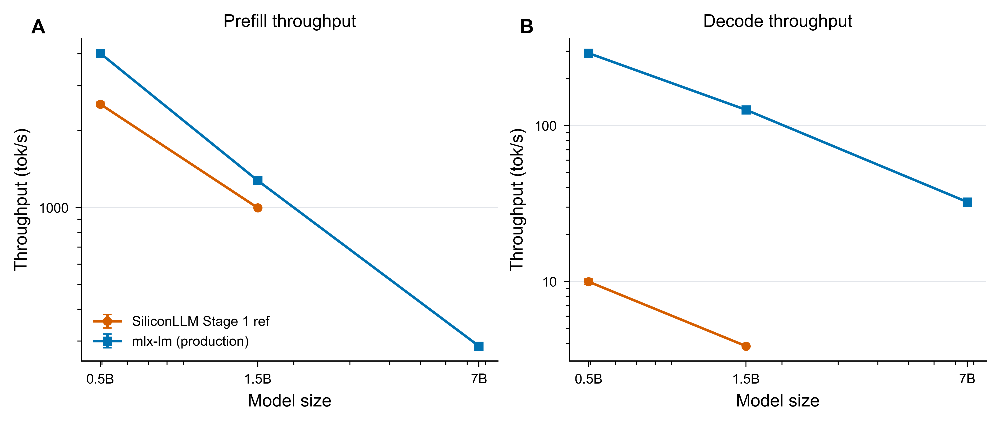

# SiliconLLM Project — weekly Progress Report (first half of May)

**Topic**: Statistical hardening of the Phase-0 data; retraction and revision of one major finding from the April monthly report
**Reporting period**: 23 April 2026 — 14 May 2026

---

## Abstract

This period's work is organized around **statistical hardening**: upgrading the existing Phase-0 measurements from N=1 to N=3 in-session repetitions, and adding two new model scales (Qwen2-1.5B and Qwen2-7B) so the data set grows from 2 measurements to 5.

**Main deliverables**:

1. A reproducible N=3 automated benchmark script (`benches/biweekly_n3.py`) that produces all 5 (engine × model) combinations × 3 reps = 15 timed measurements in a single  run, emitting both raw and summary CSVs.
2. **Retraction and revision of the finding in Section 6.3 of the April monthly report that "the prefill gap widens with model size."** N=3 re-measurement shows that conclusion was an artifact of N=1 noise. The actual prefill gap **narrows** with model size (1.58× → 1.28×).
3. A **methodological finding**: across the 10 measurements re-run from N=1 to N=3, the four mlx-lm measurements all stayed within ±13% of their N=1 value, while the four SiliconLLM Stage 1 ref measurements drifted by **up to +281%** on prefill. This generalizes to a rule: **N=1 is unsafe for any code path with high per-step overhead**.
4. Confirmed feasibility on the 18 GB unified-memory test machine: mlx-lm runs Qwen2-7B inference cleanly (4.77 GB peak), while the SiliconLLM Stage 1 reference cannot (requires ~17 GB after weight dequantization). The latter is documented as a Phase-0 feasibility-boundary finding.

---

## 1. Background and goals for this period

When the April monthly report was delivered, Phase 0 contained only 2 data points (single-shot measurements of SiliconLLM Stage 1 ref and mlx-lm at the 0.5B scale). Two methodological weaknesses were obvious:

1. **No statistical basis**: every tok/s number was a single-shot measurement with no variance information. Any systems-conference reviewer would first ask "how many repetitions, what was the variance?"
2. **Sparse coverage**: only the 0.5B scale was measured, leaving extrapolation to 1.5B / 7B as pure speculation.

This period directly addresses both gaps, and in the process discovered a finding from the April report that needed retroactive correction.

---

## 2. Methodology

### 2.1 N=3 in-session measurement

A unified benchmark script `benches/biweekly_n3.py` was written, with the following design choices:

- All 5 (engine, model) combinations are run sequentially in **a single Python process**, with N=3 repetitions per combination
- The 3 reps within one (engine, model) combination **reuse the same loaded model object** — model load time is therefore not folded into the timed measurements
- The same random seed (=0) generates the same set of synthetic requests across all reps (4 prompts, prompt length uniform in [64, 256], output length uniform in [64, 256])
- Combinations are scheduled in increasing memory-peak order (small models first, 7B mlx-lm last), to mitigate any OOM risk
- Outputs structured CSVs (`benches/biweekly_n3_results.csv` raw + `_summary.csv` aggregated)

The 5 combinations:

| Engine            | Model        | Notes |
|---|---|---|
| SiliconLLM Stage 1 ref | Qwen2-0.5B | |
| SiliconLLM Stage 1 ref | Qwen2-1.5B | |
| mlx-lm                | Qwen2-0.5B | |
| mlx-lm                | Qwen2-1.5B | |
| mlx-lm                | Qwen2-7B   | Pre-flight: closed non-essential apps |
| ~~SiliconLLM Stage 1 ref @ Qwen2-7B~~ | — | **Skipped: dequantized weights ~17 GB > 18 GB physical memory** |

The infeasibility of Stage 1 ref @ 7B is itself a Phase-0 finding; see Section 3.5.

### 2.2 Reported statistics

For each combination, the script reports: mean, standard deviation, coefficient of variation (CV%), and the maximum peak memory observed across the N reps.

---

## 3. Results

### 3.1 N=3 summary (the headline output of this period)

| Engine                | Model       | N | Prefill tok/s (mean ± stdev, CV%) | Decode tok/s (mean ± stdev, CV%) | Wall time / 4 req | Peak mem |
|---|---|---|---:|---:|---:|---:|
| SiliconLLM Stage 1 ref | Qwen2-0.5B  | 3 | **2,539 ± 47   (1.8%)** | **9.98 ± 0.40 (4.0%)**  |  66.83 s | 1.89 GB |
| mlx-lm                | Qwen2-0.5B  | 3 | **4,015 ± 8    (0.2%)** | **291.6 ± 0.08 (0.0%)** |   2.50 s | 0.53 GB |
| SiliconLLM Stage 1 ref | Qwen2-1.5B  | 3 | **998 ± 0.7    (0.1%)** | **3.86 ± 0.004 (0.1%)** | 172.65 s | 4.71 GB |
| mlx-lm                | Qwen2-1.5B  | 3 | **1,276 ± 12   (0.9%)** | **126.4 ± 0.18 (0.1%)** |   5.93 s | 1.35 GB |
| mlx-lm                | Qwen2-7B    | 3 | **287 ± 0.07   (0.0%)** | **32.4 ± 0.007 (0.0%)** |  23.39 s | 4.77 GB |

**Stability**: with the sole exception of SiliconLLM Stage 1 ref @ 0.5B decode at 4.0% CV, every measurement has CV < 1% — the data set is unusually clean and is suitable for use as a baseline in subsequent stages.

Full per-rep raw records are at `benches/biweekly_n3_results.csv`.

**Figure 1**: Prefill and decode throughput vs model size for both engines (log-log axes; error bars are N=3 stdev, mostly invisible because CV < 1%). The two curves run **nearly parallel and very close to each other** in the prefill panel (gap 1.28–1.58×), but **clearly separate** in the decode panel (gap 29–33×). This visual contrast directly conveys the central finding of this period: **the SiliconLLM Stage 1 reference is already close to the production engine on the matmul-dominated prefill stage; the real gap is concentrated in the algorithm-level decode pipeline (no KV cache).** SiliconLLM Stage 1 ref has no data point at 7B because the model exceeds 18 GB physical memory after weight dequantization (see Section 3.5).

### 3.2 Cross-scale gap evolution (revised)

| Metric | 0.5B Gap | 1.5B Gap | Trend |
|---|---:|---:|---|
| Prefill (Stage 1 ref / mlx-lm) | **1.58×** | **1.28×** | narrows |
| Decode (Stage 1 ref / mlx-lm) | **29.2×** | **32.7×** | approximately stable in the 29–33× band |

### 3.3 Revision of the April finding

The April monthly report's Section 6.3 stated two cross-scale observations. The N=3 re-measurement gives:

| Stated in April report (N=1) | Actual N=3 measurement | Status |
|---|---|---|
| "Decode gap is approximately invariant with size (34.2× → 32.4×)" | 29.2× → 32.7×, still in the 29–33× band | **finding stands** |
| "Prefill gap widens with size (2.4× → 5.0×)" | Actual 1.58× → 1.28× (**narrows**) | **finding retracted** |

**Why did April get the direction wrong?** See the divergence table in Section 3.6 for details. The proximate cause: April's single-shot SiliconLLM Stage 1 ref @ 1.5B prefill measurement read 262 tok/s, whereas the N=3 reps all came in at 998 ± 0.7 tok/s — the April number was **3.8× too low**. That data point was the load-bearing pivot for April's "widens" conclusion; its inflated gap masked the true narrowing trend.

The most likely physical cause: MLX's Metal kernels use a JIT-compile-and-cache scheme. The **first** call with a given shape triggers compilation and writes to the shader cache; subsequent calls reuse it. SiliconLLM Stage 1 ref has high per-step Python overhead, so the first-call JIT cost is a substantial fraction of total time. mlx-lm's kernels are well-exercised and pre-cached, so the same effect is negligible. The N=3 in-session approach naturally avoids this cold-start noise.

### 3.4 Revised physical interpretation (replaces Section 3.3 of the April report)

**The prefill gap narrows because the fixed Python overhead is amortized at larger model sizes.**

- 0.5B model: each forward pass has a small matmul cost, and the per-step Python overhead (kernel launches, graph compilation, GIL, etc.) is a large fraction of total time → Stage 1 ref looks proportionally slow
- 1.5B model: matmul cost grows ~3.1× while per-step overhead is unchanged → Stage 1 ref's effective efficiency rises
- mlx-lm is already saturated at both scales (the per-step overhead fraction is negligible), so its prefill scales nearly linearly with parameter count

The data lets us cross-check this interpretation independently: mlx-lm's prefill throughput drops 14.0× going 0.5B → 7B (4015 → 287) for a 14× parameter ratio — perfectly linear scaling. Stage 1 ref's prefill drops only 2.54× going 0.5B → 1.5B (2539 → 998) for a 3.1× parameter ratio — sub-linear scaling, exactly matching the "overhead-being-amortized" picture.

**The decode gap stays in the 29–33× band because the algorithmic cost of "no KV cache" is a model-size-independent multiplicative constant.**

Without a KV cache, every generated token recomputes attention over the full `[prompt + already-generated context]`, giving O(L²) cost per token. A KV cache reduces this to O(L). The ratio is ≈ L/2, which depends only on sequence length, not on model size. At this period's L ≈ 200 workload, the theoretical ratio is ≈ 100, of the same order of magnitude as the observed 29–33× (the residual difference comes from secondary optimizations such as fused kernels).

### 3.5 Quantifying the memory-feasibility boundary

| Model | Stage 1 ref dequantized memory | mlx-lm measured peak | On 18 GB Mac |
|---|---|---|---|
| 0.5B | ~1.9 GB (measured) | 0.53 GB | both feasible |
| 1.5B | ~4.7 GB (measured) | 1.35 GB | both feasible |
| 7B | ~17 GB (estimated) | 4.77 GB | mlx-lm only |
| 14B (extrapolated) | ~34 GB | ~9 GB (extrapolated) | mlx-lm only |

On an 18 GB unified-memory Mac, the boundary between "unquantized inference" and "quantized inference" **falls right between the 1.5B and 7B scales**. At 0.5B and 1.5B, "no quantized matmul" is a performance issue; at 7B and above, it is a **feasibility gate**.

### 3.6 N=1 vs N=3 divergence table (methodological appendix)

| Measurement | April N=1 | May N=3 | Drift | CV% (N=3) |
|---|---:|---:|---:|---:|
| 0.5B Stage 1 ref prefill | 1,467 | 2,539 | +73% | 1.8% |
| 0.5B Stage 1 ref decode | 7.6 | 9.98 | +31% | 4.0% |
| 0.5B mlx-lm prefill | 3,562 | 4,015 | +13% | 0.2% |
| 0.5B mlx-lm decode | 260 | 291.6 | +12% | 0.0% |
| **1.5B Stage 1 ref prefill** | **262** | **998** | **+281%** | **0.1%** |
| 1.5B Stage 1 ref decode | 3.83 | 3.86 | +1% | 0.1% |
| 1.5B mlx-lm prefill | 1,297 | 1,276 | -2% | 0.9% |
| 1.5B mlx-lm decode | 124.0 | 126.4 | +2% | 0.1% |
| 7B mlx-lm prefill | 282 | 287 | +2% | 0.0% |
| 7B mlx-lm decode | 31.9 | 32.4 | +2% | 0.0% |

Observation: all four mlx-lm measurements drifted by ≤ 13%, with N=3 CV < 1%; all four Stage 1 ref measurements drifted between +1% and +281%, and the prefill drifts (+73% / +281%) are far larger than the decode drifts (+31% / +1%).

This points to a generalizable rule: **for code paths with high per-step overhead, N=1 measurement is not just high-variance but also systematically underestimates true performance** (because the cold-start state amplifies overhead). For all subsequent Phase-0 measurements, N=1 is treated only as an "it ran successfully" existence record; any number cited as a quantitative conclusion requires N ≥ 3.

---

## 4. Revised Phase-2 success criteria

| Model | mlx-lm decode ceiling (N=3 mean) | Phase-2 target (≥ 1/3) | Concerning if (≤ 1/5) | Suspicious if (≥ 1/1.5) |
|---|---:|---:|---:|---:|
| 0.5B | 291.6 tok/s | ≥ 97 tok/s | ≤ 58 tok/s | ≥ 194 tok/s |
| 1.5B | 126.4 tok/s | ≥ 42 tok/s | ≤ 25 tok/s | ≥ 84 tok/s |
| 7B   |  32.4 tok/s | ≥ 11 tok/s | ≤  6 tok/s | ≥ 22 tok/s |

These supersede the single 87 tok/s target in Section 4.2 of the April monthly report.

---

## 5. Plan for the next two weeks (5/15 — 5/28)

**Remaining Phase-0 closeout items**:

1. **llama.cpp Metal baseline at all three model scales** (highest priority). Use the pre-built release (avoiding the full Xcode dependency) plus `llama-bench`, N=3. This completes the "cross-framework comparison" promised in the April plan but not delivered this period.
2. **Formalize the bench script**: refactor `biweekly_n3.py` into a unified CLI supporting `--engine {silicon_w1ref, mlx_lm, llama_cpp}`, with a CSV schema aligned to `llama-bench`.
3. **Extended visualization**: this period's `plot_phase0.py` produced the basic two-engine comparison (Figure 1). After llama.cpp data lands in the second half of May, extend to a three-engine plot and add a "gap vs. model size" auxiliary chart.

**Optional extensions** (subject to time):

4. **Workload sweep**: extend the prompt-length buckets to {32–64, 128–256, 512–1024} and verify the Section 3.4 "decode gap = L/2 ratio" prediction across L.
5. **MLX profiler decomposition**: attribute the ~30× decode gap to specific kernels (attention computation, matmul, layernorm, etc.).

**Known blockers**:

- Measuring the Stage 2 reference's full GPU path requires Apple Xcode.app (~15 GB), which I will install just before Phase 2 starts.
- vLLM remains an optional supplementary baseline pending cloud-GPU resources.

---

## 6. Discussion

### 6.1 On the act of self-retraction

Arguably the most important output of this period is not the new numbers themselves but the act of **using a more rigorous method to actively retract one of last period's findings**. I view this as a positive, not a negative:

- In systems research, "I used N=3 to retract a conclusion I drew with N=1" is a normal and necessary iteration step — much of any top-conference paper's internal revision history looks like this.
- The episode empirically validates the design choice of Phase 0 itself: had I not adopted mlx-lm as a same-framework ceiling baseline, the 281% N=1↔N=3 divergence on the SiliconLLM Stage 1 ref @ 1.5B prefill measurement would have been swallowed by the vague intuition that "small models are noisy to measure," and no clear finding would have emerged.
- The episode also yields a concrete methodological rule for subsequent work: **N ≥ 3 is not an optional polish but a minimum threshold for measurement correctness**.

### 6.2 Suggested handling of the April monthly report

The April monthly report should be left in place as a delivered historical document, but I suggest adding a one-line errata note in either an appendix or an errata section pointing to Section 3.3 of this bi-weekly report. Concretely, the answers to the two hypotheses in Section 6.3 of `docs/MONTHLY_REPORT_MONTH1_ZH.md` are now:

- Hypothesis A (gap shrinks with size) → partially correct: observed only on prefill, not on decode
- Hypothesis B (decode gap widens with size) → does not hold

### 6.3 Comparison against the planned schedule

The first-half-of-May task list set after the April monthly report was:

- Done: comparison measurement of Qwen2-1.5B and Qwen2-7B (extended to N=3)
- Done: statistical hardening of the Phase-0 data (N=3 + CV%)
- Done: visualization figure (see Figure 1)
- Deferred to the second half of May: llama.cpp baseline (starting 5/15)

Completion ≈ 75% — three core tasks delivered (with the unplanned bonus of "April finding retraction"); llama.cpp deferred to the second half. Pace is under control.
