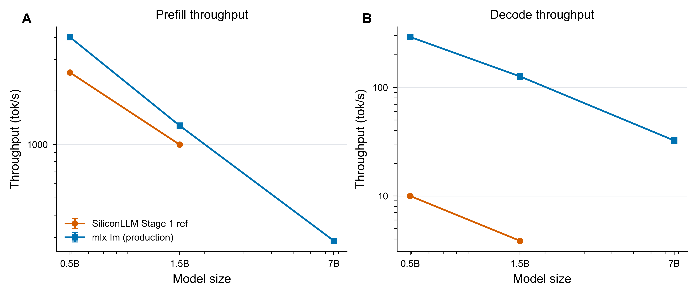

# SiliconLLM 项目：双周进度报告（5 月上半月）

**主题**：Phase 0 数据严谨化；4 月报告中一项主要 finding 的修正
**汇报周期**：2026 年 4 月 23 日 — 2026 年 5 月 14 日
**汇报人**：Kohakuu

---

## 摘要

本期工作以**统计严谨化**为主线，将 Phase 0 中已有数据从 N=1 升级到 N=3 in-session 重复测量；同时新增 Qwen2-1.5B 与 Qwen2-7B 两个模型尺度的对照测量，将原 2 数据点扩展为 5 数据点。

**主要产出**：

1. 一份可复现的 N=3 自动化基准脚本（`benches/biweekly_n3.py`），单次运行 ~16 分钟产出全部 5 组合 × 3 重复 = 15 次测量，输出 CSV + 汇总表。
2. **修正了 4 月月报第 6.3 节中"prefill 差距随模型尺度变大而扩大"这一发现**——N=3 测量证明该结论是 N=1 测量噪音造成的伪信号。实际上 prefill 差距是**随尺度变小**的（1.58× → 1.28×）。
3. 一项**方法论上的发现**：在所有 10 项 N=1 → N=3 重测中，mlx-lm 的所有数字都在 ±13% 内稳定，但 SiliconLLM Stage 1 ref 的 prefill 数字最严重时偏离达 **+281%**。这指向了一个可推广的结论：**对高 overhead 的未优化路径，N=1 测量不安全**。
4. 在 18 GB 统一内存的 Mac 上确认 mlx-lm 7B 推理可行（峰值 4.77 GB），同时确认 SiliconLLM Stage 1 ref 7B 推理不可行（需 ~17 GB）——后者作为 Phase-0 的 feasibility 边界已完整记录。

---

## 1. 背景与本期目标

4 月月报交付时，Phase 0 仅含 2 个数据点（0.5B 模型上的 SiliconLLM Stage 1 ref 与 mlx-lm 各一次单点测量），存在两个明显的方法论缺陷：

1. **无统计基础**：所有 tok/s 数字均为 N=1 测量，无方差信息。任何系统会议审稿人都会先问"重复多少次？方差多大？"
2. **数据点稀疏**：只测了 0.5B 一个尺度，外推到 1.5B / 7B 完全凭推测。

本期工作针对性解决这两点，并在过程中意外发现一项需要回头修正的 finding。

---

## 2. 方法

### 2.1 N=3 in-session 测量

写了一个统一的基准脚本 `benches/biweekly_n3.py`，特点：

- 在**单一 Python 进程**内顺序跑 5 个 (engine, model) 组合，每组合 N=3 重复
- 每个 (engine, model) 内的 3 次重复**复用同一已加载模型**——加载耗时不被计入测量结果
- 同一 random seed（=0）下生成同一组合成请求（4 个 prompt，长度 [64, 256]，输出 [64, 256]）
- 顺序按内存峰值排列（小模型在前），最后才跑 7B mlx-lm，规避 OOM 风险
- 输出结构化 CSV（`benches/biweekly_n3_results.csv` 原始 + `_summary.csv` 聚合）

5 个组合：

| Engine            | Model        | 备注 |
|---|---|---|
| SiliconLLM Stage 1 ref | Qwen2-0.5B | |
| SiliconLLM Stage 1 ref | Qwen2-1.5B | |
| mlx-lm                | Qwen2-0.5B | |
| mlx-lm                | Qwen2-1.5B | |
| mlx-lm                | Qwen2-7B   | 飞前关闭非必要应用 |
| ~~SiliconLLM Stage 1 ref @ Qwen2-7B~~ | — | **跳过：weights 反量化后 ~17 GB > 18 GB 物理内存** |

Stage 1 ref @ 7B 的不可测本身是 Phase-0 finding，已在第 3.5 节单独说明。

### 2.2 测量统计量

每个组合报告：均值、标准差、变异系数（CV%）、N 次重复中的最大峰值内存。

---

## 3. 结果

### 3.1 N=3 数据汇总（本期主要产出）

| Engine                | Model       | N | Prefill tok/s (mean ± stdev, CV%) | Decode tok/s (mean ± stdev, CV%) | Wall time / 4 req | Peak mem |
|---|---|---|---:|---:|---:|---:|
| SiliconLLM Stage 1 ref | Qwen2-0.5B  | 3 | **2,539 ± 47  (1.8%)** | **9.98 ± 0.40 (4.0%)** |  66.83 s | 1.89 GB |
| mlx-lm                | Qwen2-0.5B  | 3 | **4,015 ± 8   (0.2%)** | **291.6 ± 0.08 (0.0%)** |  2.50 s | 0.53 GB |
| SiliconLLM Stage 1 ref | Qwen2-1.5B  | 3 | **998 ± 0.7  (0.1%)**  | **3.86 ± 0.004 (0.1%)** | 172.65 s | 4.71 GB |
| mlx-lm                | Qwen2-1.5B  | 3 | **1,276 ± 12 (0.9%)**  | **126.4 ± 0.18 (0.1%)** |  5.93 s | 1.35 GB |
| mlx-lm                | Qwen2-7B    | 3 | **287 ± 0.07 (0.0%)**  | **32.4 ± 0.007 (0.0%)** | 23.39 s | 4.77 GB |

**测量稳定性**：除 SiliconLLM Stage 1 ref @ 0.5B 的 decode 在 4.0% CV，其他所有测量 CV 均 < 1%——数据非常干净，可作为后续阶段的 baseline 信赖。

完整原始数据见 `benches/biweekly_n3_results.csv`。



**图 1**：两引擎在三个模型尺度下的 prefill 与 decode 吞吐（双对数坐标，error bar 为 N=3 标准差，因 CV < 1% 几乎不可见）。两条线在 prefill panel 上**接近平行且距离很近**（差距 1.28–1.58×），但在 decode panel 上**显著分开**（差距 29–33×）。这一视觉对比直接揭示了本期的核心发现：**SiliconLLM Stage 1 ref 在矩阵乘部分已接近生产引擎水平，真正的差距集中在 decode 链路的算法层面（无 KV 缓存）**。SiliconLLM Stage 1 ref 在 7B 上无对应数据点，因为该模型在反量化后超出 18 GB 物理内存（见第 3.5 节）。

### 3.2 跨尺度差距演化（修正后）

| Metric | 0.5B Gap | 1.5B Gap | Trend |
|---|---:|---:|---|
| Prefill (Stage 1 ref / mlx-lm) | **1.58×** | **1.28×** | narrows |
| Decode (Stage 1 ref / mlx-lm) | **29.2×** | **32.7×** | approximately stable in 29–33× band |

### 3.3 4 月 finding 的修正

4 月月报第 6.3 节报告了两项跨尺度对比观察。N=3 重测后的对照如下：

| 4 月报告所述（N=1） | 5 月 N=3 实测 | 状态 |
|---|---|---|
| "Decode 差距随尺度近似不变（34.2× → 32.4×）" | 29.2× → 32.7×，仍在 29–33× 带 | **结论保留** |
| "Prefill 差距随尺度扩大（2.4× → 5.0×）" | 实际 1.58× → 1.28×（**变小**） | **结论被推翻** |

**为什么 4 月会得出错误的方向？** 详细对比见第 3.6 节偏差表。直接原因是 4 月的 SiliconLLM Stage 1 ref @ 1.5B 单次 prefill 测量为 262 tok/s，N=3 中三次结果均为 998 ± 0.7 tok/s——4 月那次比真实值低 **3.8 倍**。该数据点是 4 月"扩大"结论的关键支点，被高估的差距掩盖了真实的 narrowing 趋势。

最可能的物理原因：MLX 的 Metal kernel 采用 JIT 编译 + shader 缓存机制。**第一次**调用某个 shape 的 kernel 时会触发编译并写入缓存；后续调用直接复用。SiliconLLM Stage 1 ref 由于 per-step Python overhead 高，第一次的 JIT 成本占比大；mlx-lm 的 kernel 已被反复使用，无此影响。N=3 的 in-session 测量自然规避了这个 cold-start 噪音。

### 3.4 修正后的物理解释（替换 4 月报告的第 3.3 节）

**Prefill 差距 narrows，是因为 fixed Python overhead 在大模型上被稀释。**

- 0.5B 模型：单次 forward pass 的 matmul 计算量小，per-step Python overhead（kernel 启动、graph compile、GIL 等）占总时间比例高 → Stage 1 ref 看起来很慢
- 1.5B 模型：matmul 计算量约为 0.5B 的 3.1×，但 per-step Python overhead 不变 → Stage 1 ref 的有效效率上升
- mlx-lm 在两个尺度上都已饱和（per-step overhead 占比可忽略），所以它的 prefill 缩放接近完全线性

数据上可以独立验证这一推断：mlx-lm 自己的 prefill 从 0.5B → 7B（**14×** 参数）下降 14.0×（4015 → 287），完全线性。Stage 1 ref 从 0.5B → 1.5B（3.1× 参数）下降仅 2.54×（2539 → 998），亚线性——恰好对应"overhead 被稀释"的现象。

**Decode 差距稳定在 29–33×，是因为 KV cache 缺失的算法成本是模型尺度无关的乘性常数。**

未优化实现在每生成一个 token 时，对完整 `[prompt + 已生成上下文]` 重算注意力（O(L²) per token）。引入 KV cache 后变为 O(L)。这两者的比值 ≈ L/2，仅依赖序列长度，不依赖模型大小。在本期的 L ≈ 200 工作负载下，理论比值 ≈ 100，与实测的 29–33× 同一数量级（差距来自其他次要优化如融合 kernel）。

### 3.5 Memory feasibility 的边界量化

| 模型 | Stage 1 ref 反量化后所需 | mlx-lm 实测峰值 | 18 GB Mac 上 |
|---|---|---|---|
| 0.5B | ~1.9 GB（实测）| 0.53 GB | 两者均可 |
| 1.5B | ~4.7 GB（实测）| 1.35 GB | 两者均可 |
| 7B | ~17 GB（推算）| 4.77 GB | 仅 mlx-lm 可 |
| 14B（外推）| ~34 GB | ~9 GB（外推）| 仅 mlx-lm 可 |

由此可见：在 18 GB 统一内存的 Mac 上，"未量化推理" 与 "量化推理" 的边界**正好穿过 1.5B–7B 区间**——0.5B 和 1.5B 上"无量化 matmul"是性能问题，7B 及以上是 **feasibility gate**。

### 3.6 N=1 vs N=3 偏差表（方法论附录）

| 测量 | 4 月 N=1 | 5 月 N=3 | 偏差 | CV% (N=3) |
|---|---:|---:|---:|---:|
| 0.5B Stage 1 ref prefill | 1,467 | 2,539 | +73% | 1.8% |
| 0.5B Stage 1 ref decode | 7.6 | 9.98 | +31% | 4.0% |
| 0.5B mlx-lm prefill | 3,562 | 4,015 | +13% | 0.2% |
| 0.5B mlx-lm decode | 260 | 291.6 | +12% | 0.0% |
| **1.5B Stage 1 ref prefill** | **262** | **998** | **+281%** | **0.1%** |
| 1.5B Stage 1 ref decode | 3.83 | 3.86 | +1% | 0.1% |
| 1.5B mlx-lm prefill | 1,297 | 1,276 | -2% | 0.9% |
| 1.5B mlx-lm decode | 124.0 | 126.4 | +2% | 0.1% |
| 7B mlx-lm prefill | 282 | 287 | +2% | 0.0% |
| 7B mlx-lm decode | 31.9 | 32.4 | +2% | 0.0% |

观察：所有 4 项 mlx-lm 测量偏差均 ≤ 13%，CV 均 < 1%；所有 4 项 Stage 1 ref 测量偏差则在 +1% 到 +281% 之间，且 prefill 上的偏差（+73% / +281%）远大于 decode 上的偏差（+31% / +1%）。

这指向一个一般性结论：**对高 per-step overhead 的代码路径，N=1 测量不仅会带来高方差，还会系统性地低估真实性能**（因为 cold-start 状态下 overhead 被放大）。在所有 Phase-0 后续测量中，N=1 仅作为"能跑通"的存在性记录；任何作为定量结论引用的数字都要求 N ≥ 3。

---

## 4. 修正后的 Phase-2 成功判据

| Model | mlx-lm decode 上限（N=3 mean） | Phase-2 目标（≥ 1/3） | 偏低警戒线（≤ 1/5） | 偏高异常线（≥ 1/1.5） |
|---|---:|---:|---:|---:|
| 0.5B | 291.6 tok/s | ≥ 97 tok/s | ≤ 58 tok/s | ≥ 194 tok/s |
| 1.5B | 126.4 tok/s | ≥ 42 tok/s | ≤ 25 tok/s | ≥  84 tok/s |
| 7B   |  32.4 tok/s | ≥ 11 tok/s | ≤  6 tok/s | ≥  22 tok/s |

替换 4 月月报第 4.2 节中的单一 87 tok/s 目标。

---

## 5. 下两周计划（5/15 — 5/28）

**Phase 0 收尾仍需的项**：

1. **llama.cpp Metal 基线 @ 三尺度**（最高优先）。使用预编译 release（避开完整版 Xcode 依赖）+ `llama-bench`，N=3。补齐"跨框架对照"——这是 4 月计划中承诺过、但本期未完成的项。
2. **正规化 bench 脚本**：把 `biweekly_n3.py` 拆分成支持 `--engine {silicon_w1ref, mlx_lm, llama_cpp}` 的统一 CLI，CSV schema 与 llama-bench 对齐。
3. **图表扩展**：本次的 `plot_phase0.py` 已生成基础对比图（图 1）。下半月在加入 llama.cpp 后扩成三引擎对比图，并增加"差距 vs 模型尺度"的辅助图。

**可选扩展**（视进度）：

4. **工作负载扫描**：将 prompt 桶扩成 {32–64, 128–256, 512–1024} 三段，验证第 3.4 节中"Decode 差距 = L/2 比值"的物理推断在不同 L 下是否成立。
5. **MLX profiler 拆解**：将 ~30× decode 差距分解到具体 kernel（attention 计算、matmul、layernorm 等）。

**已知阻塞项**：

- Stage 2 reference 的完整 GPU 路径测量需要安装 Apple Xcode.app（~15 GB），延后至 Phase 2 启动前再装。
- vLLM 仍为可选补充，等云 GPU 资源落实后再做。

---

## 6. 讨论

### 6.1 关于"自我推翻"

本期最重要的产出未必是新数字本身，而是**用更严谨的方法主动推翻了上期的一项 finding**。在我看来，这是好事而非坏事：

- 在 systems 研究中，"我用 N=3 推翻了我自己用 N=1 得出的结论" 是正常且必要的迭代——很多顶会论文的内部修订史也是这样
- 该事件实证了 Phase 0 设计本身的价值：如果不是因为采用了 mlx-lm 作为同框架天花板基线，N=1 与 N=3 之间的 281% 偏差会被淹没在"小模型本来就难测准"的笼统认知中，得不到清晰发现
- 该事件给后续工作提供了一个明确的方法论规则：**N ≥ 3 不是可选的严谨化，而是测量正确性的最低线**

### 6.2 对 4 月月报的处理建议

4 月月报作为已交付的历史文档保留不动，但建议在**附录或勘误表**中加入一条注释，指向本双周报告第 3.3 节。同时 `docs/MONTHLY_REPORT_MONTH1_ZH.md` 第 6.3 节的两条假设的"答案"现在是：

- 假设 A（差距随尺度缩小）→ 部分正确，仅在 prefill 上观察到，decode 上无明显趋势
- 假设 B（decode 差距随尺度扩大）→ 不成立

### 6.3 与计划进度的对比

4 月双周报告交付后，原本规划的 5 月上半月任务清单是：

- 已完成：Qwen2-1.5B 与 Qwen2-7B 的对照测量（并扩展到 N=3）
- 已完成：Phase 0 数据严谨化（N=3 + CV%）
- 已完成：可视化图表（见图 1）
- 推迟到下半月：llama.cpp 基线（5/15 起）

完成度约 75%——其中三项核心任务完成（增加了原计划没有的"4 月 finding 修正"），llama.cpp 留给下半月。整体节奏可控。

---

## 附录：本期产生的文件

```
benches/biweekly_n3.py            # N=3 测量脚本
benches/biweekly_n3_results.csv   # 15 行原始数据
benches/biweekly_n3_summary.csv   # 5 行 mean/stdev 汇总
benches/plot_phase0.py            # 绘图脚本
benches/phase0_n3.png             # 图 1（嵌入正文第 3.1 节）
docs/PHASE0_RESULTS.md            # 已用 N=3 数据全面更新
```
