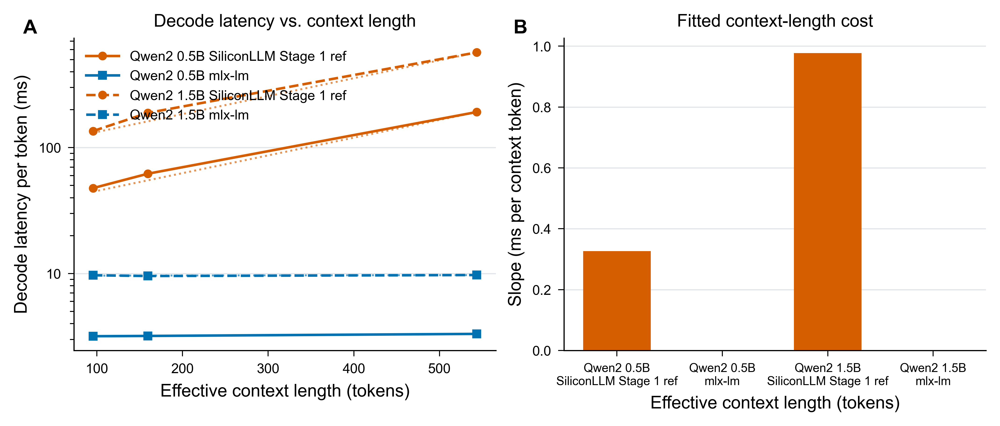

# Decode Gap Scaling Analysis

Date: 2026-05-29

## Goal

This analysis turns the prompt-length scan into a simple decode cost model.

The previous workload scan showed that the Stage 1 reference path slows down
when the prompt becomes longer, while mlx-lm stays almost flat. Here I use
the same data to estimate how much decode latency increases per additional
context token.

This is not a new model run. It is an analysis over the existing CSV files.

## Input Data

Input files:

- `benches/workload_length_scan_summary.csv`
- `benches/workload_length_scan_1p5b_summary.csv`

Output files:

- Script: `benches/analyze_decode_gap_scaling.py`
- Per-point analysis: `benches/decode_gap_scaling_analysis.csv`
- Linear fit summary: `benches/decode_gap_scaling_fit.csv`
- Figure: `benches/decode_gap_scaling_analysis.png`

## Method

For each prompt length, I convert decode throughput into latency per token:

```text
decode_ms_per_token = 1000 / decode_tok_s
```

During fixed-length generation, the context length grows after each new
token. So I use an approximate effective context length:

```text
effective_context_len = prompt_len + (gen_len - 1) / 2
```

Then I fit a simple linear model:

```text
decode_ms_per_token = intercept + slope * effective_context_len
```

The slope is the main quantity of interest. It estimates how much extra
decode latency is added by one more context token.

## Results

| Model | Engine | Slope ms per context token | R2 | Predicted decode tok/s at prompt 1024 |
|---|---|---:|---:|---:|
| Qwen2 0.5B | mlx-lm | 0.0003 | 0.999 | 287.55 |
| Qwen2 0.5B | SiliconLLM Stage 1 ref | 0.3268 | 0.998 | 2.79 |
| Qwen2 1.5B | mlx-lm | 0.0002 | 0.328 | 101.78 |
| Qwen2 1.5B | SiliconLLM Stage 1 ref | 0.9773 | 1.000 | 0.94 |



## Interpretation

The fitted slope is almost zero for mlx-lm. This matches the previous
observation that mlx-lm decode throughput is stable across prompt lengths.

For the Stage 1 reference path, the slope is large:

- Qwen2 0.5B: about 0.327 ms per extra context token
- Qwen2 1.5B: about 0.977 ms per extra context token

This means the Stage 1 reference path pays a clear per-context-token cost
during decode. The 1.5B slope is about 3.0× the 0.5B slope, which is
consistent with the larger model doing more work for each additional token.

The extrapolated prompt-1024 numbers should be treated as a rough cost-model
projection, not as a measured result. Still, the direction is useful:

- mlx-lm would remain near 288 tok/s for 0.5B and 102 tok/s for 1.5B
- Stage 1 ref would drop to about 2.8 tok/s for 0.5B and 0.94 tok/s for 1.5B

## Current Conclusion

The Phase 0 story now has a more quantitative mechanism:

- The original model-size scan showed a large decode gap.
- The prompt-length scan showed the gap grows with longer context.
- The KV-cache microbenchmark showed that full-context recompute scales badly.
- This cost-model analysis estimates the actual latency slope in the real
  Stage 1 workload.

So the next optimization target remains clear: the project should move toward
KV-cache-enabled decode, or first use MLX profiling to locate how much of this
context-length slope comes from attention, projections, and Python-level loop
overhead.

## Limitations

This analysis uses only three prompt lengths: 64, 128, and 512. The linear fit
is useful as a first-order summary, but it should not be treated as a final
scaling law.

The prompt-1024 values are projected from existing data. They should be
reported as projections, not measured results.
