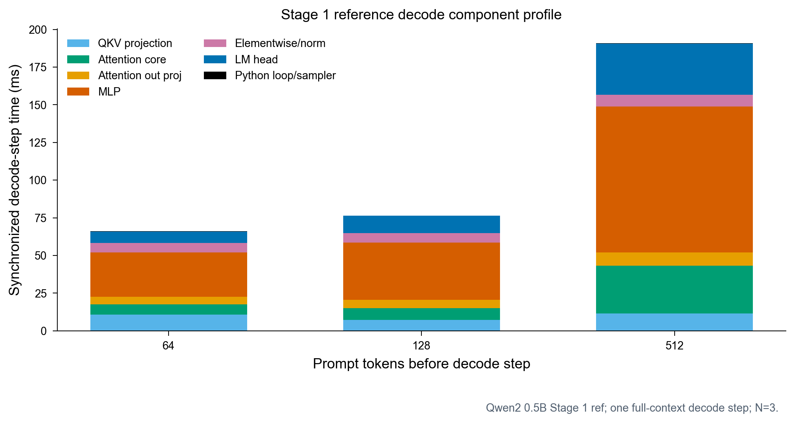
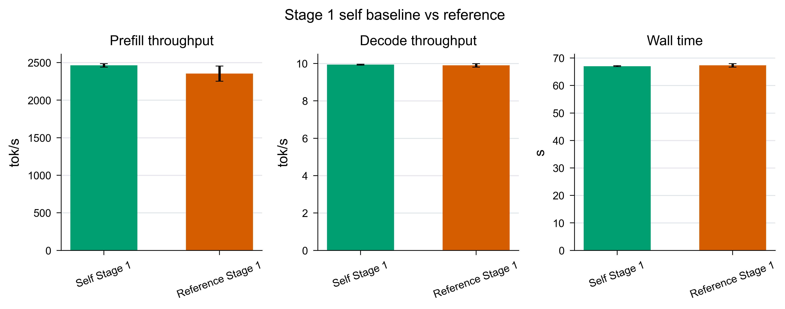

# SiliconLLM Formal Progress Update

Date: 2026-07-01

## Summary

Since the previous updates, I finished the Phase 0 evidence package, added a
small Phase 0.5 diagnostic profile, started Phase 1 implementation, and ran
the first self-vs-reference Stage 1 baseline comparison.

The main technical conclusion is now clearer:

The Stage 1 reference implementation has a large decode bottleneck because each
generated token re-runs full-context transformer computation. The bottleneck
is not mainly Python loop overhead.

This gives a clean transition into Phase 1:

First implement the faithful Stage 1 baseline, validate it against the reference
tests, verify that it matches the reference baseline, then introduce
optimizations one at a time.

## Phase 0 Status

Phase 0 now contains:

- same-framework comparison against mlx-lm
- llama.cpp Metal baseline
- prompt-length decode scan
- KV-cache microbenchmark
- decode cost-model analysis
- unified reproducibility manifest

The current result package is organized in:

- `docs/PHASE0_RESULTS.md`
- `docs/PHASE0_REPRODUCIBILITY_MANIFEST_2026-05-29.md`
- `benches/phase0_unified_summary.csv`

The unified summary table has 151 rows and keeps source files, engines,
models, workloads, metrics, units, repetition counts, and caveats.

## New Diagnostic: Stage 1 Decode Component Profile

I added a coarse component profile for one Stage 1 decode step.

The script is:

- `benches/stage1_decode_component_profile.py`

Outputs:

- `benches/stage1_decode_component_profile_results.csv`
- `benches/stage1_decode_component_profile_summary.csv`
- `benches/stage1_decode_component_profile.png`

The figure was exported in PNG, PDF, SVG, and TIFF formats using the
scientific visualization style.

## Main Numbers

The profile uses Qwen2 0.5B, one full-context decode step, and N=3 repetitions
per prompt length.

| Prompt tokens | Total measured step | MLP | LM head | Attention core | Python loop/sampler |
|---:|---:|---:|---:|---:|---:|
| 64 | 66.07 ms | 29.38 ms | 7.69 ms | 6.80 ms | 0.20 ms |
| 128 | 76.50 ms | 37.95 ms | 11.46 ms | 7.79 ms | 0.20 ms |
| 512 | 190.90 ms | 96.64 ms | 33.96 ms | 31.83 ms | 0.22 ms |

At prompt 512, the largest components are:

- MLP: 50.6%
- LM head: 17.8%
- attention core: 16.7%
- Python loop/sampler: 0.1%

## Interpretation

This profile changes the explanation slightly.

Earlier, the simple explanation was "Stage 1 decode is slow because it has no KV
cache." That is still true.

The more precise explanation is:

Because Stage 1 decode re-runs the whole sequence every time, the cost is paid
not only in attention. The MLP and LM head also scale with the full context.
Python loop overhead is measurable but not the main bottleneck.

## Why This Matters for the Next Phase

This result gives a better order for implementation work:

1. Start Phase 1 by implementing the faithful Stage 1 baseline.
2. Validate it against the reference tests.
3. Re-run the same benchmark scripts on the self-implemented baseline.
4. Only then introduce optimizations.

The first optimization target should still be KV cache, but this profile also
shows a follow-up question: after KV cache removes full-context decode, which
component becomes the new bottleneck?

## Phase 1 Stage 1 Implementation

I also started the faithful Stage 1 implementation in `src/tiny_llm/`.

Implemented components:

- attention and linear layers
- RoPE
- grouped-query attention
- RMSNorm and MLP
- Qwen2 block and model assembly
- greedy generation
- temperature, top-k, and top-p sampling

Validation so far:

| Scope | Result |
|---|---|
| Stage 1 Day 1 | 36 passed |
| Stage 1 Day 2 | 16 passed |
| Stage 1 Day 3 | 60 passed |
| Stage 1 Day 4 | 22 passed |
| Stage 1 Day 5 targeted safe subset | 12 passed, 4 deselected |
| Stage 1 Day 5 Qwen2 1.5B targeted subset | 2 passed, 14 deselected |
| Stage 1 Day 6 | official unit test skipped |
| Stage 1 Day 7 | official unit test skipped |

I did not run the full Day 5 suite because it would include Qwen2 7B Stage 1
model construction on this machine. Earlier Phase 0 measurements already
showed that this path is not feasible on the 18 GB unified-memory setup.

## Phase 1 Self Baseline Benchmark

After the implementation pass, I compared the self-implemented Stage 1 path
against the reference Stage 1 path on Qwen2 0.5B. I also added a narrow Qwen2
1.5B smoke benchmark to check whether the same pattern holds at the next model
scale.

Script:

- `benches/stage1_self_baseline_compare.py`

Outputs:

- `benches/stage1_self_baseline_compare_results.csv`
- `benches/stage1_self_baseline_compare_summary.csv`
- `benches/stage1_self_generation_sanity.csv`
- `benches/stage1_self_baseline_compare.png`
- `benches/stage1_self_baseline_compare_1p5b_smoke_summary.csv`
- `benches/stage1_self_baseline_compare_1p5b_smoke.png`

The figure was exported in PNG, PDF, SVG, and TIFF formats using the
scientific visualization style.

Results:

Qwen2 0.5B benchmark:

| Engine | N | Prefill tok/s | Decode tok/s | Wall time |
|---|---:|---:|---:|---:|
| Self Stage 1 | 3 | 2463.8 ± 23.2 | 9.94 ± 0.03 | 67.03 ± 0.18 s |
| Reference Stage 1 | 3 | 2353.7 ± 100.7 | 9.90 ± 0.10 | 67.32 ± 0.65 s |

Self/reference ratio:

- prefill throughput: 1.047×
- decode throughput: 1.004×
- wall time: 0.996×

Qwen2 1.5B smoke benchmark:

| Engine | N | Prefill tok/s | Decode tok/s | Wall time |
|---|---:|---:|---:|---:|
| Self Stage 1 | 2 | 975.4 ± 5.0 | 4.30 ± 0.00 | 39.68 ± 0.05 s |
| Reference Stage 1 | 2 | 980.8 ± 1.9 | 4.30 ± 0.01 | 39.72 ± 0.10 s |

Self/reference ratio:

- prefill throughput: 0.994×
- decode throughput: 1.001×
- wall time: 0.999×

The 1.5B result is intentionally labeled as a smoke benchmark because it uses
one request per repetition and N=2. It is useful as consistency evidence, not
as a replacement for a full N=3 sweep.

For both 0.5B and 1.5B, the short greedy generation sanity check matched
exactly for the first 16 generated token IDs.

## Research-Level Result Table

I also added a broader research-level long table:

- `benches/build_research_progress_summary.py`
- `benches/research_progress_unified_summary.csv`
- `docs/RESEARCH_PROGRESS_SUMMARY_2026-05-29.md`

This table keeps Phase 0 and Phase 1 separate with a `phase_id` column. It
currently has 175 data rows:

- Phase 0 evidence package: 151 rows
- Phase 1 self-baseline comparisons: 24 rows

This avoids renaming the Phase 0 manifest while still giving the formal update
one auditable CSV that covers the current research state.

## Next Work

The next concrete step is to polish the formal update around the current
evidence chain. Another benchmark is not necessary before 2026-07-01 unless
the presentation specifically needs a full N=3 version of the 1.5B comparison.

The optimization work should still wait. The research story is cleaner if the
sequence remains: measure first, explain the bottleneck second, implement a
correct baseline third, optimize fourth.
