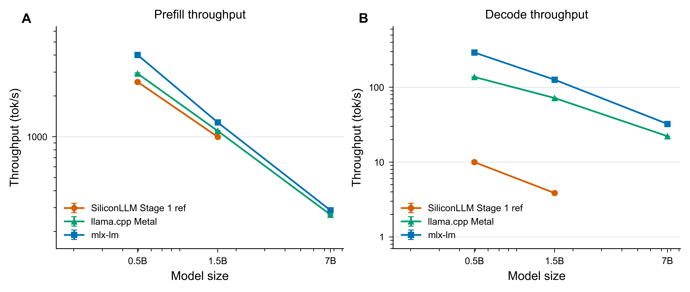

# SiliconLLM 组会进度报告

日期：2026-05-28

## 这段时间主要做了什么

这次主要继续做 Phase 0 的基准测试。

之前我们已经有两组对照：

- SiliconLLM Stage 1 reference implementation
- mlx-lm

这次新补了一组 baseline：

- llama.cpp Metal

这样现在就不是只比较“教学参考实现”和“一个生产引擎”，而是有了第三个生产级推理引擎作为对照。这个结果对后面解释性能差距比较有帮助。

## 为什么要加 llama.cpp

mlx-lm 是 Apple Silicon 上很强的生产引擎，但如果只有 mlx-lm 一个生产 baseline，结论会有点单薄。

llama.cpp 是另一个很常用的推理框架，而且也支持 Metal backend。所以这次加入 llama.cpp 的目的很直接：

- 看看另一个成熟引擎在同一台 Mac 上表现如何
- 判断 mlx-lm 的结果是不是一个孤立情况
- 给 Phase 0 增加一个更完整的对照结构

## 实验设置

硬件还是同一台机器：

- Apple M3 Pro
- 18 GB unified memory

llama.cpp 设置：

- llama.cpp version: b9354
- backend: Metal + BLAS
- 参数：`-p 128 -n 128 -t 4 -ngl 99 -r 3`

模型使用 Qwen2 Instruct 的 GGUF Q4_K_M：

- Qwen2 0.5B
- Qwen2 1.5B
- Qwen2 7B

这里的 7B 是 llama.cpp 的 Q4_K_M 量化版本，所以它和之前 mlx-lm 的 MLX 权重不是完全同一种格式。这个点需要在解释时注意一下。

## 新结果

| Engine | Model | Prefill tok/s | Decode tok/s |
|---|---:|---:|---:|
| llama.cpp Metal | Qwen2 0.5B Q4_K_M | 2,924.7 ± 36.2 | 137.3 ± 1.0 |
| llama.cpp Metal | Qwen2 1.5B Q4_K_M | 1,103.7 ± 8.3 | 71.9 ± 0.5 |
| llama.cpp Metal | Qwen2 7B Q4_K_M | 266.2 ± 2.0 | 22.2 ± 0.03 |

下面这张图把三组 engine 放在一起比较：

## 目前怎么看这个结果

最明显的结论是：llama.cpp Metal 的位置基本在 Stage 1 reference 和 mlx-lm 中间。

在 prefill 上，llama.cpp 和 mlx-lm 比较接近。尤其是 7B 上，两者差距不算大。

在 decode 上，llama.cpp 明显比 Stage 1 reference 快很多，但还是低于 mlx-lm。比如：

- 0.5B decode：llama.cpp 是 137.3 tok/s，mlx-lm 是 291.6 tok/s
- 1.5B decode：llama.cpp 是 71.9 tok/s，mlx-lm 是 126.4 tok/s
- 7B decode：llama.cpp 是 22.2 tok/s，mlx-lm 是 32.4 tok/s

所以之前的判断仍然成立：主要差距还是集中在 decode 阶段。新的 llama.cpp baseline 没有推翻这个结论，反而让这个结论更稳。

## 这次实验的意义

这次结果对项目有两个帮助。

第一，它让 Phase 0 的对照更完整。现在我们可以说：

- Stage 1 reference 是一个简单、未充分优化的下界
- llama.cpp Metal 是一个常用生产引擎 baseline
- mlx-lm 是 Apple Silicon 上表现更强的生产引擎 baseline

第二，它说明“生产引擎之间也有差异”。也就是说，我们后面不能只问“为什么 reference 慢”，还可以继续问：

- 为什么 llama.cpp decode 低于 mlx-lm？
- 这个差距来自权重格式、kernel、KV cache、调度，还是其他实现细节？

这个问题可以作为后面 profiling 的入口。

## 内存情况

这次 7B llama.cpp Metal 成功跑完了。

不过跑完之后，系统空闲内存明显变低。也就是说，7B 虽然可跑，但已经会带来比较明显的内存压力。

所以后面如果继续做 7B、长上下文或者 profiler，最好先关掉浏览器、微信、其他 IDE 这类大应用。0.5B 和 1.5B 基本不需要特别释放内存。

## 下一步计划

我觉得下一步可以先做两件事。

第一，把 llama.cpp 结果正式合并进 Phase 0 的结果文档和图表。

第二，开始做 workload length scan。也就是改变 prompt length 和 generation length，看 decode gap 会不会随着长度变化。

如果时间够，再做 MLX profiler，把 decode 差距拆得更细一点。

## 明天可以重点讲的几句话

这周我补了 llama.cpp Metal baseline。现在 Phase 0 已经有三个对照：Stage 1 reference、llama.cpp Metal 和 mlx-lm。

新结果显示，llama.cpp Metal 明显快于 Stage 1 reference，但整体还是低于 mlx-lm。这个结果说明，之前观察到的 decode bottleneck 不是偶然现象。

目前最重要的结论还是：在 Apple Silicon 上，未优化实现和生产引擎之间的主要差距集中在 decode 阶段，而不是 prefill 阶段。
