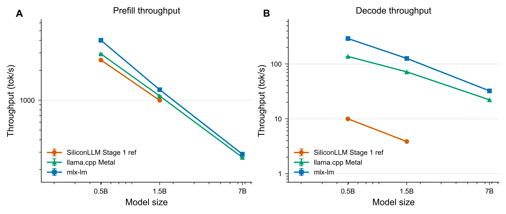

# SiliconLLM Group Meeting Update

Date: 2026-05-28

## What I Worked On

This week I continued the Phase 0 benchmark work.

Before this, I had two baselines:

- SiliconLLM Stage 1 reference implementation
- mlx-lm

This week I added one more baseline:

- llama.cpp Metal

So now the comparison is not only between a simple teaching implementation and one production engine. We now have another widely used production inference engine in the benchmark.

## Why I Added llama.cpp

mlx-lm is a strong production engine on Apple Silicon. But using only one production baseline is a bit weak.

llama.cpp is also a very common inference framework, and it supports the Metal backend on macOS. So the goal of this experiment was simple:

- test another mature engine on the same Mac
- see whether the mlx-lm result is special or more general
- make the Phase 0 comparison more complete

## Experiment Setup

The hardware is the same machine:

- Apple M3 Pro
- 18 GB unified memory

llama.cpp setup:

- llama.cpp version: b9354
- backend: Metal + BLAS
- command options: `-p 128 -n 128 -t 4 -ngl 99 -r 3`

Models:

- Qwen2 0.5B Instruct GGUF Q4_K_M
- Qwen2 1.5B Instruct GGUF Q4_K_M
- Qwen2 7B Instruct GGUF Q4_K_M

One thing to note is that the llama.cpp models use GGUF Q4_K_M. This is not exactly the same weight format as the MLX models used by mlx-lm. So the comparison is useful, but it is not a perfectly identical implementation-level comparison.

## New Results

| Engine | Model | Prefill tok/s | Decode tok/s |
|---|---:|---:|---:|
| llama.cpp Metal | Qwen2 0.5B Q4_K_M | 2,924.7 ± 36.2 | 137.3 ± 1.0 |
| llama.cpp Metal | Qwen2 1.5B Q4_K_M | 1,103.7 ± 8.3 | 71.9 ± 0.5 |
| llama.cpp Metal | Qwen2 7B Q4_K_M | 266.2 ± 2.0 | 22.2 ± 0.03 |

The figure below compares all three engines:

## How I Interpret This

The main observation is that llama.cpp Metal sits between the Stage 1 reference implementation and mlx-lm.

For prefill, llama.cpp is fairly close to mlx-lm. This is especially clear for the 7B model.

For decode, llama.cpp is much faster than the Stage 1 reference implementation, but it is still slower than mlx-lm. For example:

- 0.5B decode: llama.cpp reaches 137.3 tok/s, while mlx-lm reaches 291.6 tok/s
- 1.5B decode: llama.cpp reaches 71.9 tok/s, while mlx-lm reaches 126.4 tok/s
- 7B decode: llama.cpp reaches 22.2 tok/s, while mlx-lm reaches 32.4 tok/s

So the earlier conclusion still holds: the main gap is in the decode stage. The new llama.cpp baseline does not change this conclusion. It actually makes the conclusion more solid.

## Why This Matters

This result helps the project in two ways.

First, the Phase 0 comparison is now more complete:

- Stage 1 reference is the simple, mostly unoptimized lower baseline
- llama.cpp Metal is a common production-engine baseline
- mlx-lm is a stronger Apple Silicon production baseline

Second, the result shows that production engines are not all the same. This gives us a new question:

- Why is llama.cpp decode slower than mlx-lm?
- Is the gap from the weight format, kernels, KV cache, scheduling, or other implementation details?

This can be a good starting point for the next profiling work.

## Memory Notes

The 7B llama.cpp Metal run finished successfully.

But after the run, the system had clear memory pressure. So 7B is runnable, but it is already close enough to the machine limit that we should be careful.

For future 7B experiments, long-context tests, or profiler runs, I should close large applications first, such as browsers, chat apps, or extra IDE windows. For 0.5B and 1.5B, this is usually not necessary.

## Next Steps

I think the next two steps are:

First, merge the llama.cpp result into the Phase 0 result document and the main plots.

Second, run a workload length scan. This means changing the prompt length and generation length, and checking whether the decode gap changes with sequence length.

If there is enough time, I will also start MLX profiler work to break down the decode gap more clearly.

## Short Version for the Meeting

This week I added llama.cpp Metal as a third baseline. Now Phase 0 compares three engines: Stage 1 reference, llama.cpp Metal, and mlx-lm.

The new result shows that llama.cpp Metal is much faster than the Stage 1 reference implementation, but still slower than mlx-lm. This makes the earlier decode-bottleneck finding more reliable.

The main conclusion is still the same: on Apple Silicon, the largest gap between the simple implementation and production engines is in decode, not prefill.
