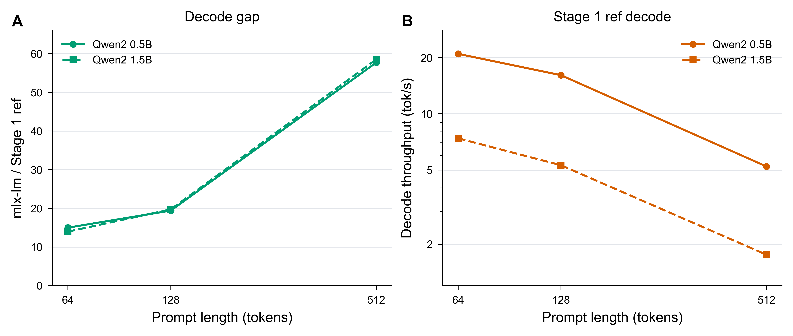
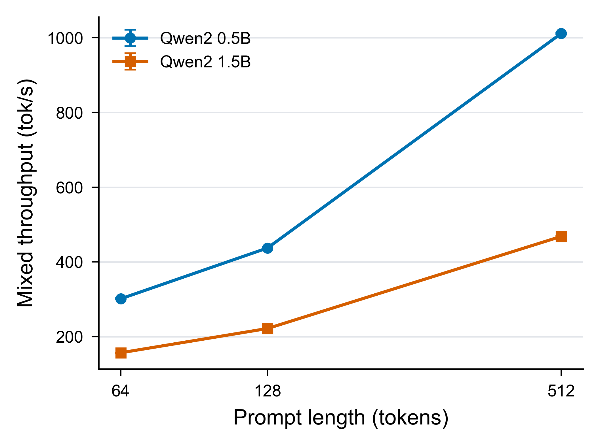
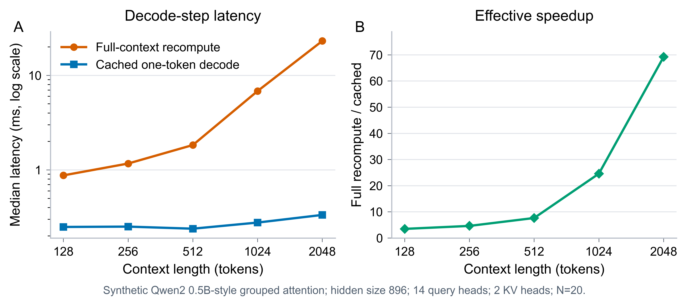

# SiliconLLM Group Meeting Update

Date: 2026-06-11

## What I Worked On

Since the last update, I continued the Phase 0 benchmark work.

Last time, I added llama.cpp Metal as a third baseline. This time, I focused on workload length. The main question was simple:

Does the decode gap change when the prompt becomes longer?

This is useful because the previous Phase 0 result mostly compared different model sizes. But in real inference, sequence length also matters. If the simple Stage 1 reference path does not use KV cache, then a longer prompt should make decode worse.

## Experiment 1: Prompt Length Scan

I compared two engines:

- SiliconLLM Stage 1 reference implementation
- mlx-lm

The models were:

- Qwen2 0.5B
- Qwen2 1.5B

The workload was:

- prompt length: 64, 128, 512 tokens
- generation length: 64 tokens
- number of requests: 2
- repetitions: N=2

For mlx-lm, I disabled EOS stopping during this benchmark so that every run used the same generation length.

## Result: Decode Gap Grows with Prompt Length

| Model | Prompt tokens | SiliconLLM decode tok/s | mlx-lm decode tok/s | Gap |
|---|---:|---:|---:|---:|
| Qwen2 0.5B | 64 | 20.98 ± 0.012 | 314.39 ± 0.026 | 15.0× |
| Qwen2 0.5B | 128 | 16.12 ± 0.005 | 312.84 ± 0.562 | 19.4× |
| Qwen2 0.5B | 512 | 5.22 ± 0.047 | 301.33 ± 0.519 | 57.7× |
| Qwen2 1.5B | 64 | 7.39 ± 0.137 | 103.19 ± 0.757 | 14.0× |
| Qwen2 1.5B | 128 | 5.30 ± 0.005 | 104.60 ± 0.037 | 19.7× |
| Qwen2 1.5B | 512 | 1.76 ± 0.035 | 102.78 ± 0.262 | 58.5× |

The result is very clear.

mlx-lm decode throughput stays almost flat when the prompt becomes longer. But SiliconLLM Stage 1 reference slows down a lot.

For Qwen2 0.5B, the decode gap grows from 15.0× to 57.7×.

For Qwen2 1.5B, the gap grows from 14.0× to 58.5×.

So the decode gap is not only related to model size. It also depends strongly on prompt length.

## How I Interpret This

This supports the earlier explanation.

The Stage 1 reference implementation recomputes attention over the full context during decode. When the prompt becomes longer, each decode step becomes more expensive.

mlx-lm uses a production decoding path with KV cache, so decode is much more stable across prompt lengths.

This gives a more direct reason for why KV cache should be the first major optimization to study in the next phase.

## Experiment 2: llama.cpp Mixed Workload Scan

I also ran a similar prompt-length scan with llama.cpp Metal.

Here I used `llama-bench -pg <prompt,gen>`. This is important because `-pg` reports mixed prompt+generation throughput. It is not pure decode throughput.

So this result should be read as an end-to-end workload measurement, not as a direct decode comparison.

## llama.cpp Result

| Model | Prompt tokens | Gen tokens | Mixed prompt+gen tok/s |
|---|---:|---:|---:|
| Qwen2 0.5B Q4_K_M | 64 | 64 | 301.2 ± 1.64 |
| Qwen2 0.5B Q4_K_M | 128 | 64 | 437.1 ± 1.71 |
| Qwen2 0.5B Q4_K_M | 512 | 64 | 1010.9 ± 1.66 |
| Qwen2 1.5B Q4_K_M | 64 | 64 | 156.7 ± 0.19 |
| Qwen2 1.5B Q4_K_M | 128 | 64 | 221.7 ± 0.62 |
| Qwen2 1.5B Q4_K_M | 512 | 64 | 468.0 ± 0.62 |

The mixed throughput increases as prompt length grows. This looks different from the decode-only result, but it makes sense.

With a longer prompt, the workload contains more prefill work. llama.cpp prefill is fast, so the mixed throughput goes up.

This is a useful reminder: different benchmark tools may report different kinds of throughput. For this project, I need to keep decode-only metrics and mixed workload metrics separate.

## Why This Matters

This update adds one more dimension to Phase 0.

Before, I mainly had:

- model size scaling
- engine comparison

Now I also have:

- prompt length scaling
- a clearer reason why KV cache matters
- one example showing why benchmark metric definitions need to be handled carefully

This makes the Phase 0 story stronger. The main conclusion is still the same, but now it is supported from another direction:

The largest problem in the simple Stage 1 reference implementation is decode, and the problem becomes worse when the context is longer.

## Experiment 3: KV Cache Microbenchmark

After the prompt-length scan, I also ran a small KV-cache microbenchmark.

This benchmark does not load real model weights. It uses a synthetic Qwen2 0.5B-style grouped attention block. The goal is to isolate the effect of KV cache without mixing in the full model, tokenizer, sampling, or other runtime overhead.

The two paths are:

- full-context recompute: compute attention over the full sequence again
- cached one-token decode: reuse previous K/V and compute attention only for the new token

The context length was changed from 128 to 2048 tokens.

## KV Cache Microbenchmark Result

| Context tokens | Full recompute median ms | Cached decode median ms | Speedup |
|---:|---:|---:|---:|
| 128 | 0.876 | 0.249 | 3.5× |
| 256 | 1.169 | 0.251 | 4.6× |
| 512 | 1.834 | 0.239 | 7.7× |
| 1024 | 6.832 | 0.278 | 24.6× |
| 2048 | 23.140 | 0.334 | 69.2× |

This result connects well with the workload scan.

The workload scan showed the symptom: Stage 1 decode becomes worse with longer prompts.

The microbenchmark gives a possible mechanism: without KV cache, full-context recompute gets much more expensive as context length grows. With KV cache, the one-token decode cost stays almost flat.

So KV cache is not just a general optimization idea. It directly targets the bottleneck observed in Phase 0.

## Next Steps

I think the next step should be to connect this microbenchmark to the real model path.

There are two possible ways to do this:

- run or implement a Stage 2 KV-cache path and compare it against Stage 1
- add a more detailed attention-only benchmark that separates projection cost, attention cost, and cache-update cost

The first option is closer to the project roadmap. The second option is useful if the full Stage 2 path is blocked by extension or environment issues.

For the next progress step, I will probably try the real Stage 2 KV-cache path first. If that is blocked, I will keep extending the controlled microbenchmark.

## Short Version for the Meeting

This time I tested whether the decode gap changes with prompt length.

The result is clear: mlx-lm stays stable, but the Stage 1 reference implementation becomes much slower with longer prompts.

For both Qwen2 0.5B and 1.5B, the gap grows from about 14 to 15× at 64 prompt tokens to about 58× at 512 prompt tokens.

This supports the idea that the missing KV cache is a major reason for the decode bottleneck.

I also tested llama.cpp with `llama-bench -pg`, but that metric is mixed prompt+generation throughput, not pure decode. This helped clarify that benchmark metrics need to be separated carefully.

Finally, I ran a KV-cache microbenchmark. It showed that full-context recompute becomes much slower with context length, while cached one-token decode stays almost flat. This gives a direct reason why KV cache should be the first optimization target after Phase 0.
