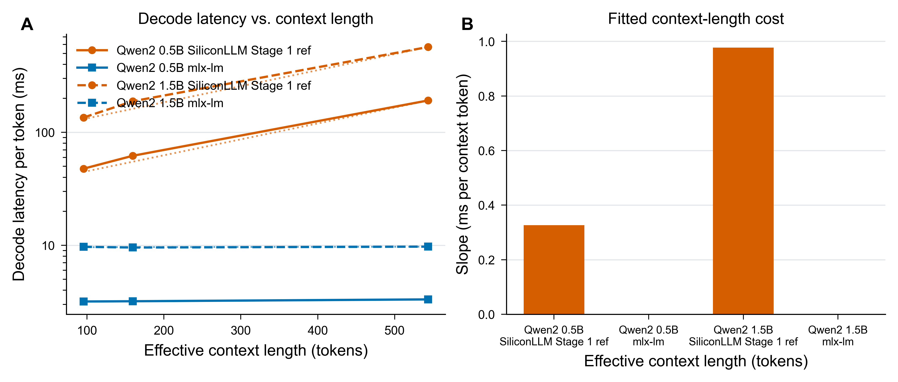

# SiliconLLM Group Meeting Update

Date: 2026-06-20

## What I Worked On

Since the last update, I continued the Phase 0 benchmark analysis.

The last report showed that the decode gap grows when the prompt becomes
longer. This time I did one more step: I turned that prompt-length scan into
a small decode cost model.

The goal was to make the result more quantitative.

Instead of only saying "the Stage 1 reference slows down with longer prompts",
I wanted to estimate:

How much decode latency is added by each extra context token?

## Background

In the Stage 1 reference implementation, decode is simple but inefficient.
For every new token, the model sees the whole context again.

That means longer prompts should make every decode step more expensive.

In contrast, production engines such as mlx-lm use a cached decoding path.
They should avoid most of this repeated full-context work.

The prompt-length scan already supported this explanation. The new analysis
tries to measure it more directly.

## Method

I reused the existing prompt-length scan results. No new model run was needed.

The input data was:

- Qwen2 0.5B and Qwen2 1.5B
- prompt lengths: 64, 128, and 512 tokens
- generation length: 64 tokens
- engines: SiliconLLM Stage 1 reference and mlx-lm

I converted decode throughput into latency per generated token:

```text
decode_ms_per_token = 1000 / decode_tok_s
```

Then I used an approximate effective context length:

```text
effective_context_len = prompt_len + (generation_len - 1) / 2
```

Finally, I fit a simple linear model:

```text
decode_ms_per_token = intercept + slope * effective_context_len
```

The slope is the important number. It tells us how much latency is added by
one more context token.

## Result

| Model | Engine | Slope ms per context token | Predicted decode tok/s at prompt 1024 |
|---|---|---:|---:|
| Qwen2 0.5B | mlx-lm | 0.0003 | 287.55 |
| Qwen2 0.5B | SiliconLLM Stage 1 ref | 0.3268 | 2.79 |
| Qwen2 1.5B | mlx-lm | 0.0002 | 101.78 |
| Qwen2 1.5B | SiliconLLM Stage 1 ref | 0.9773 | 0.94 |



The result is very clear.

For mlx-lm, the fitted slope is almost zero. This means decode latency is
almost independent of prompt length in this small range.

For the Stage 1 reference implementation, the slope is much larger:

- Qwen2 0.5B: about 0.327 ms per extra context token
- Qwen2 1.5B: about 0.977 ms per extra context token

So the Stage 1 reference path has a real per-context-token decode cost.

The 1.5B slope is about 3 times the 0.5B slope. That also makes sense: the
larger model does more work for each additional context token.

## What This Adds Beyond the Last Update

The previous update had three pieces:

- the decode gap grows with prompt length
- llama.cpp has a different mixed-throughput metric
- a KV-cache microbenchmark shows why cached decode should help

This update adds a more quantitative bridge between the real model workload
and the mechanism.

The Phase 0 story is now:

1. Model-size scan: decode is the largest gap.
2. Prompt-length scan: the gap grows with context length.
3. KV-cache microbenchmark: full-context recompute scales badly.
4. Cost-model analysis: the real Stage 1 path has a measurable
   per-context-token decode cost.

So the next optimization target is still KV cache, but now the reason is more
concrete.

## Limitations

This is still a small analysis. It only uses three prompt lengths: 64, 128,
and 512.

The prompt-1024 numbers are projections from a simple linear fit. They should
not be reported as measured benchmark results.

The analysis also does not yet say which exact kernels are responsible for
the slope. For that, I still need MLX profiler work.

## Next Steps

My next step is to use MLX profiling on the Stage 1 decode path.

The goal is to break down the decode cost into:

- attention score computation and full-context attention work
- projection and MLP matrix multiplication
- layernorm and elementwise operations
- Python-level loop overhead

If the profiler setup is too noisy, I will first make the benchmark scripts
more regular, so the same workload can be run through all engines with a
shared CSV schema.

## Short Version for the Meeting

This time I did not run another large benchmark. Instead, I analyzed the
prompt-length scan more carefully.

The result is that the Stage 1 reference implementation has a measurable
per-context-token decode cost. For Qwen2 0.5B, each extra context token adds
about 0.327 ms to decode latency. For Qwen2 1.5B, it adds about 0.977 ms.

For mlx-lm, the fitted slope is almost zero.

This makes the earlier result more concrete. The decode gap grows with prompt
length because the Stage 1 path pays repeated full-context work during decode.
The next step is MLX profiling, so I can locate which operations dominate
that cost.
