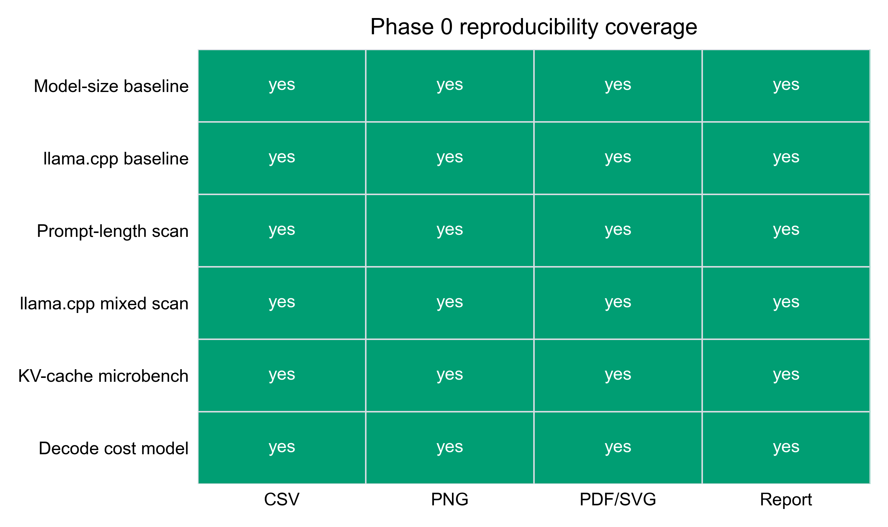

# SiliconLLM Group Meeting Update

Date: 2026-06-30

## What I Worked On

Since the last update, I did a reproducibility pass for Phase 0.

The previous updates focused on benchmark results:

- model-size scaling
- llama.cpp Metal as a third baseline
- prompt-length scaling
- KV-cache microbenchmark
- decode cost-model analysis

This time I focused on making the result package easier to audit and reuse.

The main output is a unified Phase 0 result table. It collects the separate
CSV files into one long-format summary, with experiment IDs, source files,
engine names, model names, workloads, metrics, units, and caveats.

## Why This Was Needed

By this point Phase 0 had several small experiments. Each one had its own CSV
schema:

- the original N=3 engine comparison
- llama.cpp `llama-bench` results
- prompt-length scan results
- llama.cpp mixed prompt+generation scan
- KV-cache microbenchmark
- decode cost-model fit

That is fine for exploration, but it becomes hard to track which number came
from which source.

So I added a small manifest step.

## New Artifacts

The new files are:

- `benches/build_phase0_unified_summary.py`
- `benches/phase0_unified_summary.csv`
- `benches/phase0_reproducibility_matrix.png`
- `docs/PHASE0_REPRODUCIBILITY_MANIFEST_2026-05-29.md`

The figure was exported in PNG, PDF, SVG, and TIFF formats using the
scientific visualization style.

## What Is in the Unified Table

The unified CSV has 151 rows.

| Experiment | Rows |
|---|---:|
| Model-size engine comparison | 20 |
| llama.cpp Metal baseline | 12 |
| Prompt-length decode scan | 54 |
| llama.cpp mixed workload scan | 24 |
| KV-cache microbenchmark | 25 |
| Decode cost-model fit | 16 |

Each row includes:

- experiment ID
- original source file
- engine
- model
- workload
- metric
- value
- standard deviation when available
- repetition count when available
- unit
- notes

This makes it much easier to search or filter the Phase 0 evidence later.

## Important Caveats Recorded in the Manifest

I also used the manifest to make the metric caveats explicit.

First, llama.cpp `-pg` is mixed prompt+generation throughput. It should not
be compared directly with pure decode throughput.

Second, the prompt-1024 numbers in the decode cost model are projections, not
measured benchmark results.

Third, the KV-cache microbenchmark is synthetic attention-block evidence. It
explains the mechanism, but it is not an end-to-end model benchmark.

These caveats are now attached to the unified table instead of only being
mentioned in prose.

## What This Adds Beyond the Last Update

This update does not change the main technical conclusion.

The main conclusion is still:

The Stage 1 reference implementation has a large decode bottleneck, and the
bottleneck becomes worse with longer context. KV cache is the most direct
next optimization target.

What changed is the state of the evidence package.

Before this pass, Phase 0 was a set of useful but separate experiments.

After this pass, Phase 0 is closer to a reproducible benchmark package:

1. the raw results are preserved
2. the unified table links back to the raw files
3. figures are exported in publication-ready formats
4. metric caveats are recorded in the data table
5. the same structure can later absorb Phase 1 and Phase 2 results

## Next Steps

The next step should be MLX profiling of the real Stage 1 decode path.

Now that the Phase 0 evidence is organized, the next technical question is
more specific:

Which part of the Stage 1 decode step produces the context-length slope?

The likely candidates are:

- full-context attention score computation
- repeated Q/K/V projection over the whole context
- MLP matrix multiplication
- layernorm and elementwise operations
- Python loop overhead

If MLX profiler output is difficult to interpret, I will first make a smaller
instrumented benchmark that times only one forward/decode step at fixed
context lengths.

## Short Version for the Meeting

This time I did a reproducibility pass rather than a new model run.

I created one unified Phase 0 result table with 151 rows. It collects all the
current Phase 0 evidence: model-size baselines, llama.cpp, prompt-length scan,
KV-cache microbenchmark, and decode cost-model analysis.

The main technical finding is unchanged. The decode bottleneck is still the
central issue, and KV cache remains the first major optimization target.

The new value is that Phase 0 is now easier to audit and extend. Later, when I
start Phase 1 or Phase 2, I can add the new results into the same unified
schema instead of creating another isolated benchmark file.
