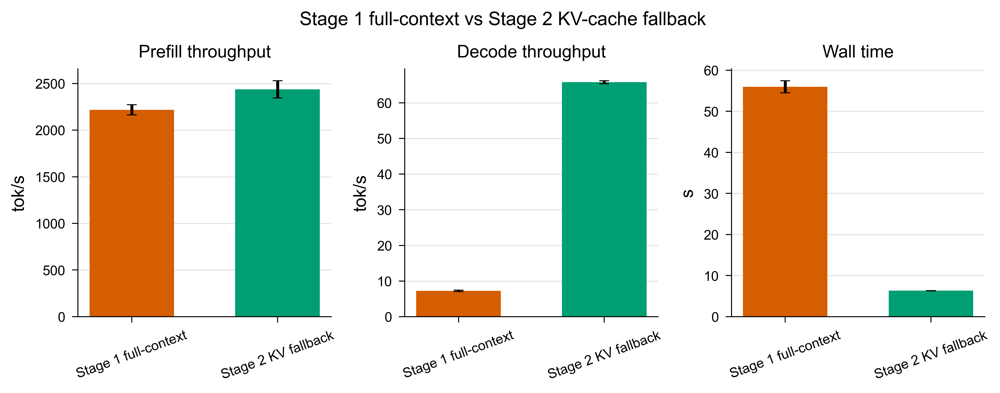

# SiliconLLM Group Meeting Update

Date: 2026-08-12

## What I Worked On

Since the last update, I ran the first Phase 2 fallback benchmark.

The goal was to check whether the Stage 2 KV-cache path actually addresses the
decode bottleneck that Phase 0 identified.

This is still a fallback path, not the final optimized kernel path. The Stage 2
model uses my KV-cache implementation, but quantized matmul is currently routed
through MLX built-in `mx.quantized_matmul`.

## Benchmark Setup

Script:

- `benches/stage2_kv_fallback_benchmark.py`

Model:

- Qwen2 0.5B

Engines:

- Stage 1 full-context decode
- Stage 2 KV-cache fallback

Workload:

- 2 synthetic requests
- input length sampled from [64, 256]
- output length sampled from [64, 256]
- seed 0
- N=3
- model loading time not counted

Outputs:

- `benches/stage2_kv_fallback_benchmark_results.csv`
- `benches/stage2_kv_fallback_benchmark_summary.csv`
- `benches/stage2_kv_fallback_benchmark.png`

The figure was exported in PNG, PDF, SVG, and TIFF formats using the
scientific visualization style.



## Results

| Engine | N | Prefill tok/s | Decode tok/s | Wall time | Peak memory |
|---|---:|---:|---:|---:|---:|
| Stage 1 full-context | 3 | 2217.6 ± 54.7 | 7.27 ± 0.20 | 55.97 ± 1.46 s | 1.89 GB |
| Stage 2 KV fallback | 3 | 2436.7 ± 92.4 | 65.78 ± 0.41 | 6.32 ± 0.03 s | 0.93 GB |

Stage 2 / Stage 1 ratio:

- prefill throughput: 1.099×
- decode throughput: 9.054×
- wall time: 0.113×
- peak memory: 0.493×

## Interpretation

This result is consistent with the earlier diagnosis.

Stage 1 decode is slow because every generated token re-runs the full context.
The Stage 2 fallback path stores K/V states and decodes one token at a time, so
decode throughput improves from 7.27 tok/s to 65.78 tok/s.

The main point is not the exact absolute throughput yet. The main point is
that the implementation-side result now matches the Phase 0 explanation.

## Caveat

This is not a pure custom-kernel result.

The Stage 2 path uses MLX built-in quantized matmul, so the benchmark should be
labeled as:

```text
Stage 2 KV-cache fallback
```

The next attribution question is how much additional gain custom quantized
matmul or custom Flash Attention can add beyond this fallback path.

## Short Version for the Meeting

I ran the first Stage 1 vs Stage 2 fallback benchmark on Qwen2 0.5B.

The Stage 2 KV-cache fallback improves decode throughput by 9.05× and reduces
wall time to about 11% of the Stage 1 full-context path.

This is the first direct implementation evidence that removing full-context
decode recomputation addresses the bottleneck measured in Phase 0.
