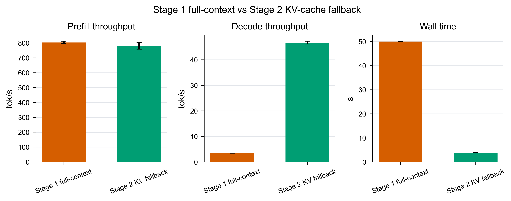

# SiliconLLM Group Meeting Update

Date: 2026-08-26

## What I Worked On

After the 0.5B Stage 2 fallback benchmark, I added a narrower 1.5B smoke
benchmark and folded the Phase 2 rows into the research-level summary table.

The goal was to check whether the Stage 2 fallback improvement still appears at
the next model size, without running a heavy 7B or long-context experiment.

## New 1.5B Smoke Benchmark

Script:

- `benches/stage2_kv_fallback_benchmark.py`

Command:

```bash
pdm run python benches/stage2_kv_fallback_benchmark.py --model qwen2-1.5b --reps 2 --num-seqs 1 --output-stem stage2_kv_fallback_benchmark_1p5b_smoke
```

Setup:

- Qwen2 1.5B
- 1 synthetic request per repetition
- input length sampled from [64, 256]
- output length sampled from [64, 256]
- seed 0
- N=2
- model loading time not counted

This is a smoke benchmark, not a full N=3 sweep.



## Results

| Engine | N | Prefill tok/s | Decode tok/s | Wall time | Peak memory |
|---|---:|---:|---:|---:|---:|
| Stage 1 full-context | 2 | 803.5 ± 7.8 | 3.41 ± 0.01 | 50.03 ± 0.10 s | 4.50 GB |
| Stage 2 KV fallback | 2 | 780.4 ± 22.3 | 46.66 ± 0.55 | 3.85 ± 0.05 s | 1.93 GB |

Stage 2 / Stage 1 ratio:

- prefill throughput: 0.971×
- decode throughput: 13.673×
- wall time: 0.077×
- peak memory: 0.428×

## Research Table Update

I also updated:

- `benches/build_research_progress_summary.py`
- `benches/research_progress_unified_summary.csv`
- `docs/RESEARCH_PROGRESS_SUMMARY_2026-05-29.md`

The research-level summary now has 199 data rows:

| Phase | Rows |
|---|---:|
| Phase 0 evidence package | 151 |
| Phase 1 self-baseline checks | 24 |
| Phase 2 KV fallback checks | 24 |

## Interpretation

The 1.5B smoke result points in the same direction as the 0.5B benchmark.

The Stage 2 fallback path improves decode throughput strongly and lowers peak
memory, which is exactly what we would expect if full-context recomputation was
the main problem.

The result should still be described carefully. It is a smoke benchmark, and
the Stage 2 path uses MLX built-in quantized matmul, not a custom kernel.

## Next Step

The next decision is about attribution.

There are two options:

1. stay with the MLX fallback path and design cleaner ablations
2. install full Xcode and start custom C++/Metal quantized matmul and Flash
   Attention work

I think the cleaner next step is to design one attribution benchmark first,
because the current fallback result already shows that KV-cache style decoding
removes most of the original bottleneck.

## Short Version for the Meeting

I extended the Stage 2 KV-cache fallback benchmark to a 1.5B smoke setting.

The 1.5B result shows a 13.67× decode improvement and a lower peak memory
footprint. I also added the Phase 2 rows to the research-level summary table,
which now has 199 data rows across Phase 0, Phase 1, and Phase 2.

The next question is no longer whether KV-cache style decoding helps. The next
question is how to attribute the remaining gains between KV cache, quantized
matmul, Flash Attention, and batching.
