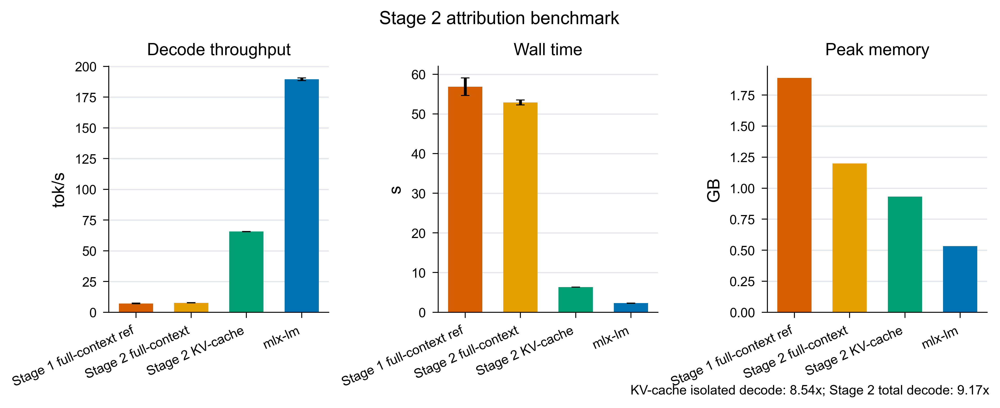

# Group Meeting Report: Stage 2 Attribution Result

Date: 2026-10-14

## Goal

The goal for this checkpoint is to present the measured Stage 2 attribution
result and use it to decide the next engineering direction.

## Benchmark

Command:

```bash
pdm run python benches/stage2_attribution_benchmark.py --model qwen2-0.5b --reps 3 --num-seqs 2 --output-stem stage2_attribution_benchmark
```

Artifacts:

- `benches/stage2_attribution_benchmark_summary.csv`
- `benches/stage2_attribution_benchmark_ratios.csv`
- `benches/stage2_attribution_benchmark.png`
- `docs/PHASE2_ATTRIBUTION_BENCHMARK_2026-05-30.md`



## Result

| Arm | Decode tok/s | Wall time | Peak memory |
|---|---:|---:|---:|
| Stage 1 full-context ref | 7.16 | 56.84 s | 1.89 GB |
| Stage 2 full-context | 7.69 | 52.87 s | 1.20 GB |
| Stage 2 KV-cache | 65.65 | 6.34 s | 0.93 GB |
| mlx-lm | 189.43 | 2.30 s | 0.53 GB |

Key attribution ratios:

| Comparison | Decode ratio | Wall-time ratio |
|---|---:|---:|
| Stage 2 full-context / Stage 1 ref | 1.073x | 0.930x |
| Stage 2 KV-cache / Stage 2 full-context | 8.542x | 0.120x |
| mlx-lm / Stage 2 KV-cache | 2.886x | 0.362x |
| Stage 2 KV-cache / Stage 1 ref | 9.168x | 0.111x |

## Interpretation

The result separates the Stage 2 gain cleanly:

- the Stage 2 implementation stack alone only improves decode by 1.073x;
- the persistent KV-cache path improves decode by 8.542x over the Stage 2
  full-context control;
- mlx-lm still has a 2.886x decode advantage over the Stage 2 KV-cache fallback.

This means the major August gain was structural: it came from removing
full-context decode recomputation. The remaining gap is now a lower-level
systems question.

## Next Step

Do not start custom C++/Metal immediately. First profile Stage 2 KV-cache decode
and split the remaining cost into attention, quantized projections, MLP, LM
head, elementwise work, and Python loop overhead.
