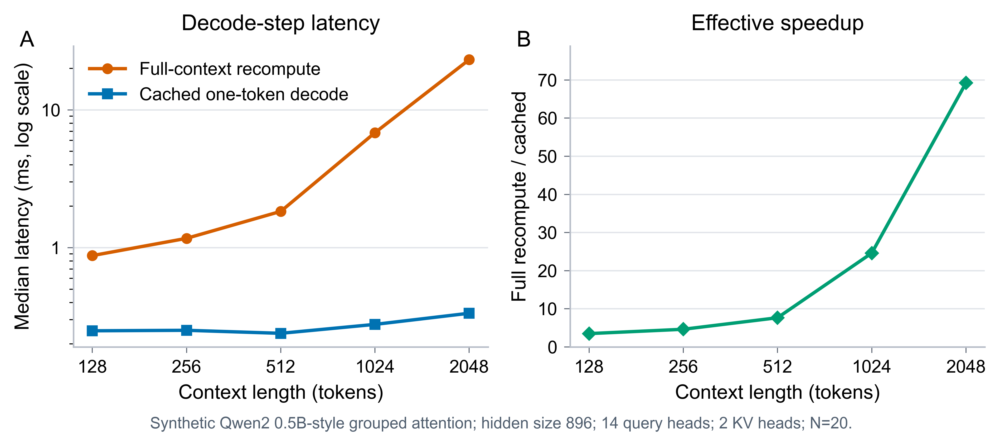

# KV Cache Microbenchmark

Date: 2026-05-28

## Goal

This microbenchmark checks whether KV cache can isolate decode cost from context-length growth.

The previous workload-length scan showed that SiliconLLM Stage 1 reference decode becomes much slower when the prompt becomes longer. The likely reason is that the Stage 1 path recomputes attention over the full context during decode.

This experiment tests that idea in a smaller controlled setting.

## Setup

This is a synthetic attention-block benchmark. It does not load real model weights.

The shape follows a Qwen2 0.5B-style grouped attention block:

- hidden size: 896
- query heads: 14
- KV heads: 2
- head dimension: 64
- batch size: 1
- context length: 128, 256, 512, 1024, 2048 tokens
- repetitions: N=20

Two paths are compared:

- full-context recompute: project Q/K/V for the whole context and compute causal attention for all positions
- cached one-token decode: assume previous K/V are already cached, project only the new token, append it to the cache, and compute attention for one token

Files:

- Script: `benches/kv_cache_microbench.py`
- Raw results: `benches/kv_cache_microbench_results.csv`
- Summary: `benches/kv_cache_microbench_summary.csv`
- Figure PNG: `benches/kv_cache_microbench.png`
- Figure PDF: `benches/kv_cache_microbench.pdf`
- Figure SVG: `benches/kv_cache_microbench.svg`
- Figure TIFF: `benches/kv_cache_microbench.tiff`

## Results

| Context tokens | Full recompute median ms | Cached decode median ms | Speedup |
|---:|---:|---:|---:|
| 128 | 0.876 | 0.249 | 3.5× |
| 256 | 1.169 | 0.251 | 4.6× |
| 512 | 1.834 | 0.239 | 7.7× |
| 1024 | 6.832 | 0.278 | 24.6× |
| 2048 | 23.140 | 0.334 | 69.2× |



The figure was redrawn using the `scientific-visualization` skill guidance: white background, colorblind-friendly colors, reduced chart decoration, publication-friendly vector export, and no bold title styling.

## Interpretation

The result supports the KV-cache explanation.

Full-context recompute becomes much slower as context length grows. The median latency increases from 0.876 ms at 128 tokens to 23.140 ms at 2048 tokens.

Cached one-token decode stays almost flat. The median latency stays around 0.25 to 0.33 ms across the same context-length range.

This means KV cache changes the scaling behavior of decode. Instead of recomputing all previous keys and values at every step, the cached path mostly pays for the new token and attends over the stored cache.

## Current Conclusion

This microbenchmark connects the Phase 0 measurement to the next optimization step.

The workload-length scan showed the symptom:

- Stage 1 decode gap grows with prompt length.

This microbenchmark shows the likely mechanism:

- full-context recompute scales poorly with context length
- cached one-token decode stays close to flat

So KV cache is a reasonable first optimization target after Phase 0.

## Limitations

This is a synthetic benchmark. It isolates one grouped attention block and does not include the full model, tokenizer, sampling, MLP, or all runtime overhead.

It should be used as a controlled explanation figure, not as a direct end-to-end throughput number.

I also checked whether the real Stage 2 reference path can be built and benchmarked. It is currently blocked by the local Metal compiler setup:

```text
xcrun: error: unable to find utility "metal", not a developer tool or in PATH
```

So the full Stage 2 KV-cache comparison should wait until the full Xcode toolchain is available, or until a non-extension fallback path is prepared.
