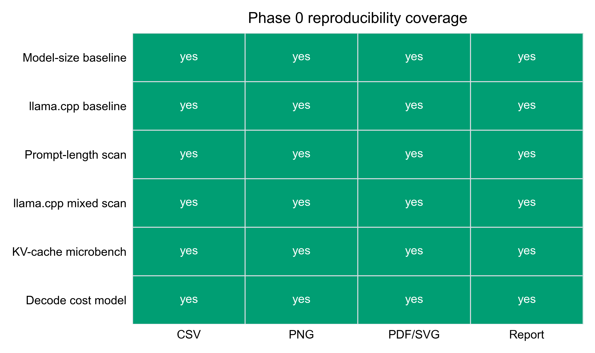

# Phase 0 Reproducibility Manifest

Date: 2026-05-29

## Goal

This manifest records the current Phase 0 evidence package in one place.

The previous work produced several separate benchmark files: model-size
baselines, llama.cpp baselines, prompt-length scans, a KV-cache
microbenchmark, and a decode cost-model analysis. This pass turns those
separate outputs into a more auditable result package.

No model inference was run for this manifest. It only reads existing CSV
files.

## New Artifacts

| Artifact | Path |
|---|---|
| Unified long-format result table | `benches/phase0_unified_summary.csv` |
| Build script | `benches/build_phase0_unified_summary.py` |
| Coverage figure PNG | `benches/phase0_reproducibility_matrix.png` |
| Coverage figure PDF | `benches/phase0_reproducibility_matrix.pdf` |
| Coverage figure SVG | `benches/phase0_reproducibility_matrix.svg` |
| Coverage figure TIFF | `benches/phase0_reproducibility_matrix.tiff` |



## Unified Table Schema

The unified CSV uses a long format:

| Column | Meaning |
|---|---|
| `experiment_id` | Which Phase 0 experiment produced the row |
| `source_file` | Original CSV file |
| `engine` | Engine identifier |
| `engine_label` | Human-readable engine name |
| `model` | Model identifier |
| `model_label` | Human-readable model name |
| `workload` | Workload description |
| `metric` | Metric name |
| `statistic` | Mean, median, ratio, or fit |
| `value` | Numeric value |
| `stdev` | Standard deviation where available |
| `n` | Repetition count where available |
| `unit` | Unit |
| `notes` | Caveats such as build number or projection status |

This format makes it easier to filter by experiment, engine, model, or metric
without manually opening several different CSV files.

## Included Experiments

| Experiment | Rows in unified table | Primary source |
|---|---:|---|
| Model-size engine comparison | 20 | `benches/biweekly_n3_summary.csv` |
| llama.cpp Metal baseline | 12 | `benches/llama_cpp/llama_cpp_b9354_summary.csv` |
| Prompt-length decode scan | 54 | `benches/workload_length_scan_summary.csv`, `benches/workload_length_scan_1p5b_summary.csv` |
| llama.cpp mixed workload scan | 24 | `benches/llama_cpp/llama_cpp_workload_length_scan_summary.csv` |
| KV-cache microbenchmark | 25 | `benches/kv_cache_microbench_summary.csv` |
| Decode cost-model fit | 16 | `benches/decode_gap_scaling_fit.csv` |

Total: 151 rows.

## Reproducibility Status

| Experiment | CSV | Figure | Report |
|---|---|---|---|
| Model-size engine comparison | Yes | Yes | Yes |
| llama.cpp Metal baseline | Yes | Yes | Yes |
| Prompt-length decode scan | Yes | Yes | Yes |
| llama.cpp mixed workload scan | Yes | Yes | Yes |
| KV-cache microbenchmark | Yes | Yes | Yes |
| Decode cost-model fit | Yes | Yes | Yes |

## Important Metric Caveats

The unified CSV intentionally keeps metric names explicit.

For llama.cpp prompt-length scans, `mixed_tps` is not the same as pure decode
throughput. It comes from `llama-bench -pg <prompt,gen>`, so it includes both
prompt processing and generation.

For the decode cost-model fit, prompt-1024 values are projections from a
linear fit. They are not measured benchmark results.

For the KV-cache microbenchmark, the data is synthetic attention-block data.
It should be used as mechanism evidence, not as end-to-end model throughput.

## Command

```bash
pdm run python benches/build_phase0_unified_summary.py
```

## Current Conclusion

This pass does not change the technical conclusion of Phase 0. Instead, it
improves auditability.

The current evidence chain is:

1. The model-size scan shows decode is the largest gap.
2. llama.cpp Metal confirms the finding with an independent production engine.
3. The prompt-length scan shows the gap grows with context length.
4. The KV-cache microbenchmark explains why cached decode should help.
5. The decode cost-model fit quantifies the context-length slope.
6. The unified result table makes the evidence easier to reproduce and extend.

The next research step is still MLX profiling of the real Stage 1 decode path,
but the Phase 0 result package is now in better shape for reporting and later
comparison against Phase 1 and Phase 2.
