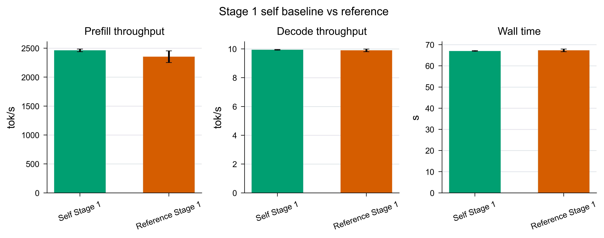

# Phase 1 Self Baseline Benchmark

Date: 2026-05-29

## Goal

This benchmark checks whether the self-implemented Stage 1 baseline behaves
like the Stage 1 reference implementation before any optimization work begins.

This is important for the 2026-07-01 update:

- Phase 0 measured the bottleneck.
- Phase 0.5 explained the bottleneck with a component profile.
- Phase 1 now has a self-implemented Stage 1 baseline that matches the
  reference path on correctness and first performance measurements.

## Method

Script:

```bash
pdm run python benches/stage1_self_baseline_compare.py
```

Setup:

- Model: Qwen2 0.5B
- Engines:
  - `tiny_llm` self-implemented Stage 1
  - `tiny_llm_ref` Stage 1 reference
- Workload:
  - 4 synthetic requests
  - input length sampled from [64, 256]
  - output length sampled from [64, 256]
  - seed 0
  - N=3
- Model loading time is not counted.

The same script also runs a short greedy generation sanity check with 16
generated tokens.

Files:

- Script: `benches/stage1_self_baseline_compare.py`
- Raw CSV: `benches/stage1_self_baseline_compare_results.csv`
- Summary CSV: `benches/stage1_self_baseline_compare_summary.csv`
- Generation sanity CSV: `benches/stage1_self_generation_sanity.csv`
- Figure: `benches/stage1_self_baseline_compare.png`
- Vector exports: `benches/stage1_self_baseline_compare.pdf`,
  `benches/stage1_self_baseline_compare.svg`
- TIFF export: `benches/stage1_self_baseline_compare.tiff`

This result has also been added to the broader research-level summary:

- `benches/research_progress_unified_summary.csv`
- `docs/RESEARCH_PROGRESS_SUMMARY_2026-05-29.md`

Additional 1.5B smoke files:

- Summary CSV: `benches/stage1_self_baseline_compare_1p5b_smoke_summary.csv`
- Generation sanity CSV: `benches/stage1_self_baseline_compare_1p5b_smoke_generation_sanity.csv`
- Figure: `benches/stage1_self_baseline_compare_1p5b_smoke.png`
- Vector exports: `benches/stage1_self_baseline_compare_1p5b_smoke.pdf`,
  `benches/stage1_self_baseline_compare_1p5b_smoke.svg`
- TIFF export: `benches/stage1_self_baseline_compare_1p5b_smoke.tiff`



## Results

| Engine | N | Prefill tok/s | Decode tok/s | Wall time |
|---|---:|---:|---:|---:|
| Self Stage 1 | 3 | 2463.8 ± 23.2 | 9.94 ± 0.03 | 67.03 ± 0.18 s |
| Reference Stage 1 | 3 | 2353.7 ± 100.7 | 9.90 ± 0.10 | 67.32 ± 0.65 s |

Self/reference ratio:

| Metric | Ratio |
|---|---:|
| Prefill throughput | 1.047× |
| Decode throughput | 1.004× |

The self implementation is effectively performance-equivalent to the Stage 1
reference on this 0.5B workload.

## Additional 1.5B Smoke Benchmark

I also ran a narrower Qwen2 1.5B smoke benchmark:

```bash
pdm run python benches/stage1_self_baseline_compare.py --model qwen2-1.5b --reps 2 --num-seqs 1 --output-stem stage1_self_baseline_compare_1p5b_smoke
```

This run uses one request per repetition and N=2, so it is not a full N=3
benchmark. Its purpose is only to check whether the self/reference parity
still holds at the next model size.

| Engine | N | Prefill tok/s | Decode tok/s | Wall time |
|---|---:|---:|---:|---:|
| Self Stage 1 | 2 | 975.4 ± 5.0 | 4.30 ± 0.00 | 39.68 ± 0.05 s |
| Reference Stage 1 | 2 | 980.8 ± 1.9 | 4.30 ± 0.01 | 39.72 ± 0.10 s |

Self/reference ratio:

| Metric | Ratio |
|---|---:|
| Prefill throughput | 0.994× |
| Decode throughput | 1.001× |
| Wall time | 0.999× |

The 1.5B greedy sanity check also matched exactly for the first 16 generated
token IDs.

## Generation Sanity Check

Prompt:

```text
Give me a short introduction to large language models.
```

Both engines produced the same first 16 greedy token IDs:

```text
20286 4128 4119 525 20443 11229 5942 429 646 6923 3738 12681 1467 3118 389 12624
```

Decoded text:

```text
 Large language models are artificial intelligence systems that can generate human-like text based on patterns
```

This is a stronger sanity check than just passing unit tests: the
self-implemented model and the reference path make the same greedy generation
decision for the tested prefix.

## Additional Correctness Check

I also ran a safe 1.5B correctness subset:

```bash
pdm run test --week 1 --day 5 -- -k "qwen_2_15b"
```

Result:

```text
2 passed, 14 deselected
```

I still did not run the 7B Stage 1 test path because the local 7B model exists
and earlier Phase 0 measurements already showed that Stage 1 7B dequantization
is not feasible on the 18 GB unified-memory machine.

## Interpretation

This result closes the first Phase 1 loop:

The self-implemented Stage 1 baseline is not only unit-test-correct for the
component path, but also matches the reference implementation in a small N=3
throughput benchmark and a greedy generation sanity check.

This makes the next research step cleaner. Optimization should still wait, but
the implementation is now credible enough to be discussed in the 2026-07-01
update across both the 0.5B benchmark and the 1.5B smoke check.
