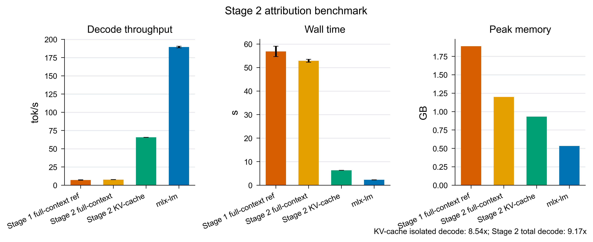

# Phase 2 Stage 2 Attribution Benchmark

Date: 2026-05-30

## Goal

The August two-arm benchmark showed that Stage 2 KV-cache fallback is much
faster than Stage 1 full-context decode. This benchmark answers the next
question: where does that speedup come from?

The benchmark separates four arms:

| Arm | Purpose |
|---|---|
| Stage 1 full-context ref | Original full-context decode baseline |
| Stage 2 full-context | Self implementation stack without persistent decode KV cache |
| Stage 2 KV-cache | Current correctness-first KV-cache fallback path |
| mlx-lm | Production MLX reference |

## Command

```bash
pdm run python benches/stage2_attribution_benchmark.py --model qwen2-0.5b --reps 3 --num-seqs 2 --output-stem stage2_attribution_benchmark
```

## Artifacts

- Script: `benches/stage2_attribution_benchmark.py`
- Raw CSV: `benches/stage2_attribution_benchmark_results.csv`
- Summary CSV: `benches/stage2_attribution_benchmark_summary.csv`
- Ratio CSV: `benches/stage2_attribution_benchmark_ratios.csv`
- Figure: `benches/stage2_attribution_benchmark.png`
- Vector exports: `benches/stage2_attribution_benchmark.pdf`,
  `benches/stage2_attribution_benchmark.svg`
- TIFF export: `benches/stage2_attribution_benchmark.tiff`



## Summary

Qwen2 0.5B, N=3, 2 synthetic requests, seed 0.

| Arm | Prefill tok/s | Decode tok/s | Wall time | Peak memory |
|---|---:|---:|---:|---:|
| Stage 1 full-context ref | 2075.9 +/- 182.0 | 7.16 +/- 0.27 | 56.84 +/- 2.21 s | 1.89 GB |
| Stage 2 full-context | 2407.8 +/- 44.9 | 7.69 +/- 0.09 | 52.87 +/- 0.61 s | 1.20 GB |
| Stage 2 KV-cache | 2437.2 +/- 31.3 | 65.65 +/- 0.10 | 6.34 +/- 0.01 s | 0.93 GB |
| mlx-lm | 3369.6 +/- 7.3 | 189.43 +/- 1.09 | 2.30 +/- 0.02 s | 0.53 GB |

## Attribution Ratios

| Comparison | Decode ratio | Wall-time ratio | Interpretation |
|---|---:|---:|---|
| Stage 2 full-context / Stage 1 ref | 1.073x | 0.930x | Implementation-stack change alone is small |
| Stage 2 KV-cache / Stage 2 full-context | 8.542x | 0.120x | Persistent KV-cache is the dominant gain |
| mlx-lm / Stage 2 KV-cache | 2.886x | 0.362x | A substantial production-engine gap remains |
| Stage 2 KV-cache / Stage 1 ref | 9.168x | 0.111x | Total measured Stage 2 fallback gain |

## Interpretation

The attribution result is clean:

1. Stage 2 full-context barely changes decode throughput relative to Stage 1
   full-context. It improves decode by only 1.073x.
2. Stage 2 KV-cache improves decode by 8.542x over the Stage 2 full-context
   control. This identifies persistent KV-cache decode as the main source of
   the August speedup.
3. mlx-lm still improves decode by 2.886x over the Stage 2 KV-cache fallback.
   The remaining gap should be attributed to production-engine mechanisms:
   lower-level kernels, graph/runtime behavior, tighter generation loop
   integration, and memory layout choices.

## Research Consequence

The next implementation step should not be another two-arm benchmark. The
project now has enough evidence to move from "does KV-cache help?" to "what
remaining mechanism explains the 2.9x gap to mlx-lm?"

This supports two possible next steps:

1. a Stage 2 profiler that splits Stage 2 KV-cache decode into attention,
   quantized projection, MLP, LM head, elementwise work, and Python loop cost;
2. a Stage 3 topic selection, with Speculative Decoding currently lower risk
   than Paged Attention for an 11月底 completion target.

## Caveats

- This benchmark uses Qwen2 0.5B only.
- Stage 2 full-context is a control arm that creates a fresh cache inside each
  full-context forward call; it is not intended as an optimized serving path.
- mlx-lm token accounting comes from `stream_generate`; the comparison is most
  important directionally, while Stage 1/Stage 2 attribution is fully
  same-workload and same-runner controlled.
