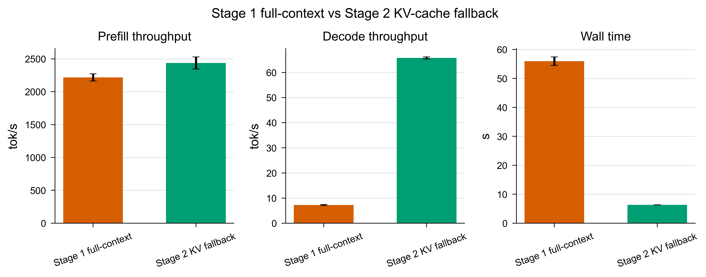
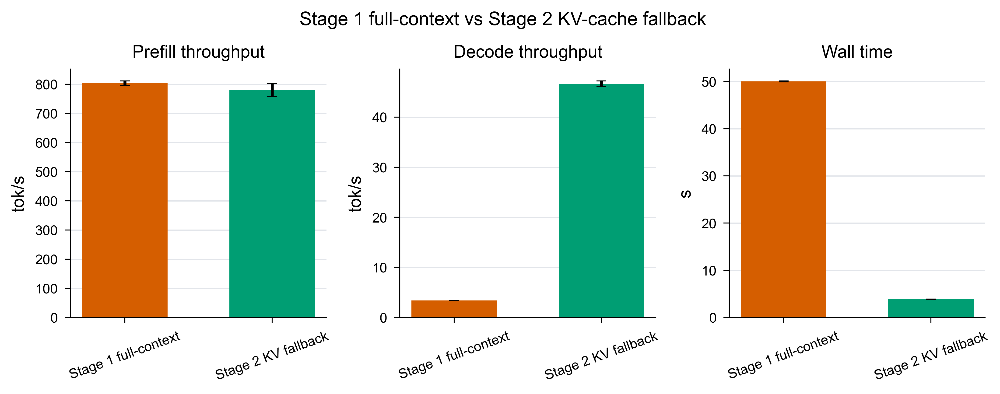

# Phase 2 KV-Cache Fallback Benchmark

Date: 2026-05-29

Target reporting window: 2026-08-12 and 2026-08-26

## Goal

This benchmark measures the first Phase 2 correctness-first path:

- Stage 1 full-context decode
- Stage 2 KV-cache decode with MLX built-in quantized matmul fallback

The goal is to test whether removing full-context decode recomputation produces
the expected decode improvement before doing custom C++/Metal kernel work.

## Important Boundary

This is not a custom kernel benchmark.

The Stage 2 path uses:

- self-implemented KV cache and Stage 2 Qwen2 wrapper
- MLX built-in `mx.quantized_matmul`
- MLX fallback wrapper for Flash Attention compatibility

So the correct label is:

```text
Stage 2 KV-cache fallback
```

Do not present this as:

```text
custom quantized matmul
custom Flash Attention
final Stage 2 optimized serving
```

## Script and Outputs

Script:

```bash
pdm run python benches/stage2_kv_fallback_benchmark.py
```

0.5B outputs:

- `benches/stage2_kv_fallback_benchmark_results.csv`
- `benches/stage2_kv_fallback_benchmark_summary.csv`
- `benches/stage2_kv_fallback_benchmark.png`
- `benches/stage2_kv_fallback_benchmark.pdf`
- `benches/stage2_kv_fallback_benchmark.svg`
- `benches/stage2_kv_fallback_benchmark.tiff`

1.5B smoke command:

```bash
pdm run python benches/stage2_kv_fallback_benchmark.py --model qwen2-1.5b --reps 2 --num-seqs 1 --output-stem stage2_kv_fallback_benchmark_1p5b_smoke
```

1.5B smoke outputs:

- `benches/stage2_kv_fallback_benchmark_1p5b_smoke_results.csv`
- `benches/stage2_kv_fallback_benchmark_1p5b_smoke_summary.csv`
- `benches/stage2_kv_fallback_benchmark_1p5b_smoke.png`
- `benches/stage2_kv_fallback_benchmark_1p5b_smoke.pdf`
- `benches/stage2_kv_fallback_benchmark_1p5b_smoke.svg`
- `benches/stage2_kv_fallback_benchmark_1p5b_smoke.tiff`

Figures were exported in PNG, PDF, SVG, and TIFF formats using the scientific
visualization style.



## Qwen2 0.5B Result

Setup:

- model: Qwen2 0.5B
- workload: 2 synthetic requests
- input length sampled from [64, 256]
- output length sampled from [64, 256]
- seed: 0
- N=3
- model loading time not counted

| Engine | N | Prefill tok/s | Decode tok/s | Wall time | Peak memory |
|---|---:|---:|---:|---:|---:|
| Stage 1 full-context | 3 | 2217.6 ± 54.7 | 7.27 ± 0.20 | 55.97 ± 1.46 s | 1.89 GB |
| Stage 2 KV fallback | 3 | 2436.7 ± 92.4 | 65.78 ± 0.41 | 6.32 ± 0.03 s | 0.93 GB |

Stage 2 / Stage 1 ratio:

| Metric | Ratio |
|---|---:|
| Prefill throughput | 1.099× |
| Decode throughput | 9.054× |
| Wall time | 0.113× |
| Peak memory | 0.493× |

## Qwen2 1.5B Smoke Result

Setup:

- model: Qwen2 1.5B
- workload: 1 synthetic request
- input length sampled from [64, 256]
- output length sampled from [64, 256]
- seed: 0
- N=2
- model loading time not counted

This is a narrow smoke benchmark, not a full N=3 sweep.



| Engine | N | Prefill tok/s | Decode tok/s | Wall time | Peak memory |
|---|---:|---:|---:|---:|---:|
| Stage 1 full-context | 2 | 803.5 ± 7.8 | 3.41 ± 0.01 | 50.03 ± 0.10 s | 4.50 GB |
| Stage 2 KV fallback | 2 | 780.4 ± 22.3 | 46.66 ± 0.55 | 3.85 ± 0.05 s | 1.93 GB |

Stage 2 / Stage 1 ratio:

| Metric | Ratio |
|---|---:|
| Prefill throughput | 0.971× |
| Decode throughput | 13.673× |
| Wall time | 0.077× |
| Peak memory | 0.428× |

## Interpretation

The result is consistent with the Phase 0 diagnosis.

Stage 1 decode is slow because every generated token re-runs the full context.
The Stage 2 fallback path stores K/V states and decodes one new token at a time,
so decode throughput improves strongly even before custom kernels.

The main finding is:

- 0.5B decode improves by 9.05×
- 1.5B smoke decode improves by 13.67×
- peak memory is also lower in the fallback path

This is the first direct implementation-side evidence connecting the Phase 0
diagnosis to a Phase 2 mechanism.

## Caveats

The 1.5B result is a smoke benchmark with fewer repetitions and fewer requests.

The Stage 2 path uses MLX built-in quantized matmul, so this benchmark mixes two
changes relative to Stage 1:

- KV-cache decode
- quantized-weight execution through MLX built-ins

Therefore, the result should be used as Phase 2 fallback evidence, not as a
pure isolated KV-cache-only ablation.

The next clean attribution step is to separate KV-cache effects from
quantized-matmul effects more carefully, or to keep the label explicit in every
figure and report.
