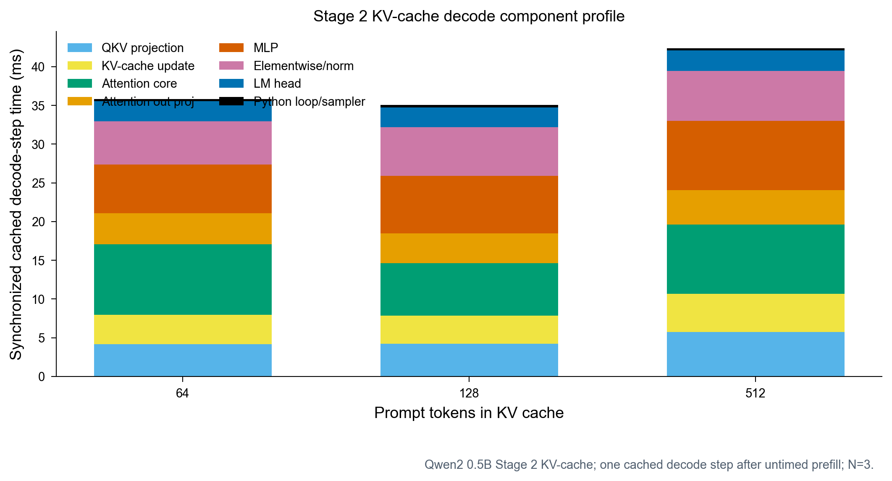

# Phase 2 Stage 2 KV-Cache Decode Component Profile

Date: 2026-05-30

## Goal

The Stage 2 attribution benchmark showed that persistent KV-cache decode gives
the dominant Stage 2 speedup, while mlx-lm still has a 2.886x decode advantage
over the Stage 2 KV-cache fallback path. This profile asks where the remaining
Stage 2 KV-cache decode time goes.

## Command

```bash
pdm run python benches/stage2_decode_component_profile.py --model qwen2-0.5b --prompt-lens 64,128,512 --reps 3 --warmup 1
```

## Artifacts

- Script: `benches/stage2_decode_component_profile.py`
- Raw CSV: `benches/stage2_decode_component_profile_results.csv`
- Summary CSV: `benches/stage2_decode_component_profile_summary.csv`
- Figure: `benches/stage2_decode_component_profile.png`
- Vector exports: `benches/stage2_decode_component_profile.pdf`,
  `benches/stage2_decode_component_profile.svg`
- TIFF export: `benches/stage2_decode_component_profile.tiff`



## Method

For each prompt length, the script:

1. runs an untimed prefill to build a fresh KV cache,
2. materializes the cache,
3. times one cached decode step,
4. repeats the process for three independent profiling reps.

This means the profile measures the decode step, not the prefill.

## Results

Qwen2 0.5B, one cached decode step, N=3.

| Prompt tokens in cache | Total measured time |
|---:|---:|
| 64 | 35.81 ms |
| 128 | 35.05 ms |
| 512 | 42.39 ms |

Prompt length 64:

| Component | Mean time | Share |
|---|---:|---:|
| QKV projection | 4.17 ms | 11.6% |
| KV-cache update | 3.77 ms | 10.5% |
| Attention core | 9.15 ms | 25.5% |
| Attention output projection | 4.00 ms | 11.2% |
| MLP | 6.28 ms | 17.5% |
| Elementwise/norm | 5.60 ms | 15.6% |
| LM head | 2.60 ms | 7.2% |
| Python loop/sampler | 0.25 ms | 0.7% |

Prompt length 512:

| Component | Mean time | Share |
|---|---:|---:|
| QKV projection | 5.75 ms | 13.6% |
| KV-cache update | 4.92 ms | 11.6% |
| Attention core | 8.93 ms | 21.1% |
| Attention output projection | 4.44 ms | 10.5% |
| MLP | 8.95 ms | 21.1% |
| Elementwise/norm | 6.43 ms | 15.2% |
| LM head | 2.66 ms | 6.3% |
| Python loop/sampler | 0.32 ms | 0.8% |

## Interpretation

The profile narrows the remaining gap to mlx-lm:

1. Python loop and sampler overhead are below 1% of the synchronized cached
   decode step. The remaining 2.886x gap to mlx-lm is not primarily a Python
   outer-loop issue in this micro-profile.
2. Attention core, MLP, QKV/out projections, KV-cache update, and elementwise
   work all contribute meaningful cost. There is no single pure-Python
   bottleneck to remove.
3. KV-cache update itself is about 10-12% of the measured decode step, so cache
   bookkeeping/layout is a real part of the Stage 2 cost model.
4. MLP and attention remain large even after full-context recomputation is
   removed. This supports profiling lower-level kernels before starting custom
   C++/Metal implementation.

## Research Consequence

The next implementation decision should be based on lower-level evidence:

- If custom kernels are pursued, they should target quantized projection/MLP and
  attention layout first.
- If Stage 3 is pursued first, Speculative Decoding remains the lower-risk
  advanced-serving topic because Stage 2's remaining gap is not explained by a
  simple Python loop fix.

## Caveats

- The timings are synchronized coarse regions, not individual Metal kernel
  traces.
- The prefill that builds the cache is intentionally not counted.
- The profiler mutates a fresh cache per repetition, so results should be read
  as one-step decode costs rather than long-run serving throughput.
