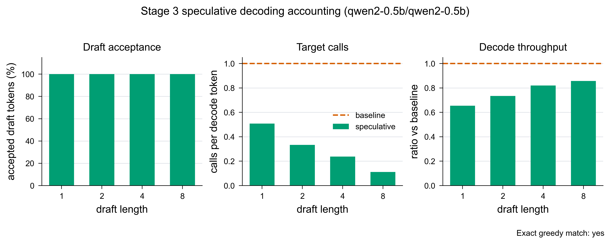
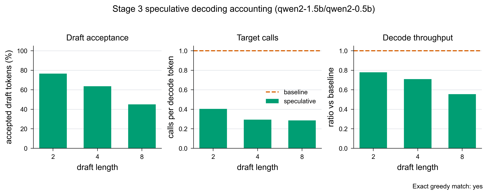
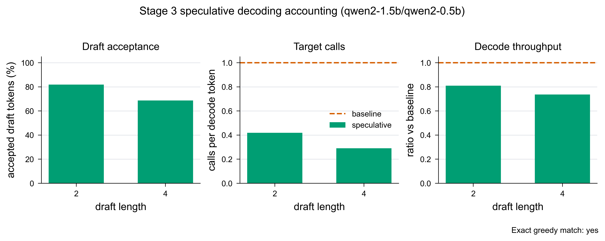

# Phase 3 Speculative Decoding Accounting

Date: 2026-05-30

## Goal

This experiment starts Stage 3 with a narrow greedy speculative decoding
prototype. The goal is not to claim production serving speedup yet, but to
measure the basic mechanism:

- whether speculative greedy output exactly matches target greedy output;
- how draft length changes acceptance rate;
- how much the target-model call count drops;
- whether that drop is enough to improve decode throughput in this prototype.

## Artifacts

| Artifact | Path |
|---|---|
| Benchmark script | `benches/stage3_speculative_accounting.py` |
| 0.5B self-pair raw CSV | `benches/stage3_speculative_accounting_results.csv` |
| 0.5B self-pair summary CSV | `benches/stage3_speculative_accounting_summary.csv` |
| 0.5B self-pair ratios CSV | `benches/stage3_speculative_accounting_ratios.csv` |
| 0.5B self-pair figure | `benches/stage3_speculative_accounting.png` |
| 1.5B/0.5B N=3 raw CSV | `benches/stage3_speculative_accounting_qwen2_1p5b_draft0p5b_results.csv` |
| 1.5B/0.5B N=3 summary CSV | `benches/stage3_speculative_accounting_qwen2_1p5b_draft0p5b_summary.csv` |
| 1.5B/0.5B N=3 ratios CSV | `benches/stage3_speculative_accounting_qwen2_1p5b_draft0p5b_ratios.csv` |
| 1.5B/0.5B N=3 figure | `benches/stage3_speculative_accounting_qwen2_1p5b_draft0p5b.png` |
| 1.5B/0.5B smoke raw CSV | `benches/stage3_speculative_accounting_qwen2_1p5b_draft0p5b_smoke_results.csv` |
| 1.5B/0.5B smoke summary CSV | `benches/stage3_speculative_accounting_qwen2_1p5b_draft0p5b_smoke_summary.csv` |
| 1.5B/0.5B smoke ratios CSV | `benches/stage3_speculative_accounting_qwen2_1p5b_draft0p5b_smoke_ratios.csv` |
| 1.5B/0.5B smoke figure | `benches/stage3_speculative_accounting_qwen2_1p5b_draft0p5b_smoke.png` |

Figures were exported with the `scientific-visualization` skill as PNG, PDF,
SVG, and TIFF.

## Commands

```bash
pdm run python benches/stage3_speculative_accounting.py \
  --target-model qwen2-0.5b \
  --draft-model qwen2-0.5b \
  --draft-lengths 1,2,4,8 \
  --reps 2 \
  --num-seqs 2 \
  --min-prompt-len 64 \
  --max-prompt-len 96 \
  --max-new-tokens 64
```

```bash
pdm run python benches/stage3_speculative_accounting.py \
  --target-model qwen2-1.5b \
  --draft-model qwen2-0.5b \
  --draft-lengths 2,4,8 \
  --reps 3 \
  --num-seqs 2 \
  --min-prompt-len 64 \
  --max-prompt-len 96 \
  --max-new-tokens 64 \
  --output-stem stage3_speculative_accounting_qwen2_1p5b_draft0p5b
```

Early smoke command:

```bash
pdm run python benches/stage3_speculative_accounting.py \
  --target-model qwen2-1.5b \
  --draft-model qwen2-0.5b \
  --draft-lengths 2,4 \
  --reps 1 \
  --num-seqs 1 \
  --min-prompt-len 64 \
  --max-prompt-len 64 \
  --max-new-tokens 32 \
  --output-stem stage3_speculative_accounting_qwen2_1p5b_draft0p5b_smoke
```

## Method

The benchmark compares:

1. Stage 2 KV-cache greedy decoding with the target model only.
2. Stage 3 greedy speculative decoding with a target model and draft model.

For each speculative draft length, the script verifies that the generated token
IDs exactly match the target greedy baseline. This is the correctness guard for
the prototype.

The prototype uses the current Stage 2 KV-cache path. It is an accounting and
algorithmic prototype, not a fused production implementation.

## 0.5B Self-Pair Result

This run uses Qwen2 0.5B as both target and draft. It is an upper-bound
correctness case: acceptance should be 100%, but speedup should not be expected
because the draft model has the same cost as the target model.



| Mode | Draft length | Acceptance | Target calls / decode token | Decode throughput | Decode ratio |
|---|---:|---:|---:|---:|---:|
| Stage 2 KV-cache greedy | 0 | n/a | 1.000 | 66.47 tok/s | 1.000x |
| Stage 3 speculative | 1 | 100.0% | 0.508 | 43.52 tok/s | 0.655x |
| Stage 3 speculative | 2 | 100.0% | 0.333 | 48.82 tok/s | 0.734x |
| Stage 3 speculative | 4 | 100.0% | 0.238 | 54.49 tok/s | 0.820x |
| Stage 3 speculative | 8 | 100.0% | 0.111 | 56.93 tok/s | 0.856x |

All speculative outputs exactly matched the target greedy baseline.

Interpretation:

- The target-call reduction mechanism works.
- A longer draft length reduces target calls per decode token.
- With an equal-cost draft, the prototype remains slower than the baseline.
- This confirms that target-call reduction alone is not a sufficient speedup
  claim.

## 1.5B Target / 0.5B Draft N=3 Result

This formal Stage 3 sweep uses Qwen2 1.5B as target and Qwen2 0.5B as draft
over 2 requests and 3 repetitions.



| Mode | Draft length | Acceptance | Target calls / decode token | Decode throughput | Decode ratio |
|---|---:|---:|---:|---:|---:|
| Stage 2 KV-cache greedy | 0 | n/a | 1.000 | 50.70 tok/s | 1.000x |
| Stage 3 speculative | 2 | 76.5% | 0.405 | 39.52 tok/s | 0.780x |
| Stage 3 speculative | 4 | 63.6% | 0.294 | 35.98 tok/s | 0.710x |
| Stage 3 speculative | 8 | 45.0% | 0.286 | 28.14 tok/s | 0.555x |

All draft lengths in the formal sweep exactly matched the target greedy
baseline.

Interpretation:

- The realistic target/draft pair preserves exact greedy correctness for draft
  lengths 2, 4, and 8.
- Acceptance falls as draft length grows: 76.5%, 63.6%, then 45.0%.
- Target calls per decode token decrease strongly, but the improvement
  saturates between draft length 4 and 8 because lower acceptance cancels the
  longer proposal window.
- The decode-time split shows that draft-model work dominates the speculative
  path: 64.4% of decode time at draft length 2, 70.7% at draft length 4, and
  71.5% at draft length 8. Target verification falls to 35.5%, 29.2%, and
  28.5%, while miscellaneous Python/cache bookkeeping stays near 0.1%.
- End-to-end decode throughput still decreases, which means the current
  prototype pays too much draft and verification overhead for this workload.

## 1.5B Target / 0.5B Draft Smoke Result

This smoke run uses Qwen2 1.5B as target and Qwen2 0.5B as draft.



| Mode | Draft length | Acceptance | Target calls / decode token | Decode throughput | Decode ratio |
|---|---:|---:|---:|---:|---:|
| Stage 2 KV-cache greedy | 0 | n/a | 1.000 | 51.17 tok/s | 1.000x |
| Stage 3 speculative | 2 | 81.8% | 0.419 | 41.46 tok/s | 0.810x |
| Stage 3 speculative | 4 | 68.8% | 0.290 | 37.66 tok/s | 0.736x |

All speculative outputs exactly matched the target greedy baseline.

Interpretation:

- The realistic target/draft pair preserves exact greedy correctness in this
  narrow smoke test.
- Acceptance is non-trivial, but it drops from 81.8% at draft length 2 to 68.8%
  at draft length 4.
- Target calls per decode token decrease strongly, from 1.000 to 0.419 and
  0.290.
- End-to-end decode throughput still decreases, which means the current
  prototype pays too much draft and verification overhead for this small
  workload.

## Stage 3 Conclusion

The formal Stage 3 result is now measurable:

```text
Speculative decoding is algorithmically correct for the formal greedy sweep and
does reduce target-model calls, but this implementation does not yet produce a
decode speedup on the measured workloads.
```

This is still a useful research result. It turns Stage 3 from a planned topic
into a measured tradeoff: the next question is not whether speculative decoding
can reduce target calls, but whether a cheaper draft path, better verification
batching, longer decode workloads, or lower overhead can turn the call-count
reduction into wall-time speedup.

## Follow-Up Output-Length Scan

A follow-up output-length scan has been added:

- `docs/PHASE3_SPECULATIVE_LENGTH_SCAN_2026-05-30.md`
- `benches/stage3_speculative_length_scan.py`

The scan shows that longer generated outputs improve the speculative decode
ratio, reaching 0.874x at 256 output tokens with draft length 4, but the current
prototype still remains below the Stage 2 KV-cache baseline.

## Limitations

- The formal 1.5B/0.5B result is N=3 but still uses a small synthetic workload.
- Draft length 1 produced an exact-match failure in a separate debug run, likely
  due to batched-verifier numerical differences near an argmax boundary; it is
  not included in the formal sweep.
- The implementation is a Python/MLX prototype using the current Stage 2
  KV-cache path.
- It does not use fused verifier kernels or production serving optimizations.
- The self-pair result is only a correctness and accounting upper-bound case.
