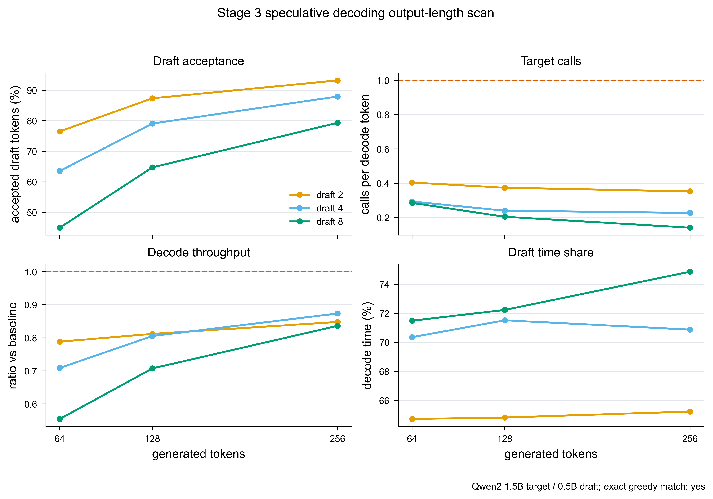

# Phase 3 Speculative Decoding Output-Length Scan

Date: 2026-05-30

## Goal

This experiment extends the Stage 3 speculative decoding accounting benchmark
by varying generated output length. The question is:

```text
Does speculative decoding become more competitive when the generated sequence
is longer and fixed overhead is amortized?
```

## Artifacts

| Artifact | Path |
|---|---|
| Benchmark script | `benches/stage3_speculative_length_scan.py` |
| Raw CSV | `benches/stage3_speculative_length_scan_results.csv` |
| Summary CSV | `benches/stage3_speculative_length_scan_summary.csv` |
| Ratios CSV | `benches/stage3_speculative_length_scan_ratios.csv` |
| Figure | `benches/stage3_speculative_length_scan.png` |

The figure was exported with the `scientific-visualization` skill as PNG, PDF,
SVG, and TIFF.

## Command

```bash
pdm run python benches/stage3_speculative_length_scan.py \
  --target-model qwen2-1.5b \
  --draft-model qwen2-0.5b \
  --draft-lengths 2,4,8 \
  --output-lengths 64,128,256 \
  --reps 2 \
  --num-seqs 2 \
  --min-prompt-len 64 \
  --max-prompt-len 96
```

## Result



| Output tokens | Draft length | Acceptance | Target calls / decode token | Decode ratio | Exact match |
|---:|---:|---:|---:|---:|---:|
| 64 | 2 | 76.5% | 0.405 | 0.788x | yes |
| 64 | 4 | 63.6% | 0.294 | 0.709x | yes |
| 64 | 8 | 45.0% | 0.286 | 0.554x | yes |
| 128 | 2 | 87.4% | 0.374 | 0.812x | yes |
| 128 | 4 | 79.1% | 0.240 | 0.805x | yes |
| 128 | 8 | 64.7% | 0.205 | 0.707x | yes |
| 256 | 2 | 93.2% | 0.353 | 0.848x | yes |
| 256 | 4 | 87.9% | 0.227 | 0.874x | yes |
| 256 | 8 | 79.3% | 0.141 | 0.836x | yes |

All measured speculative runs exactly matched the target greedy baseline.

## Interpretation

Longer output helps:

- acceptance improves as output length increases;
- target calls per decode token decrease, especially for draft length 8;
- decode ratio improves from the 64-token setting to the 256-token setting.

But the current prototype still does not cross 1.0x decode throughput. The best
measured point is draft length 4 at 256 output tokens:

```text
decode ratio = 0.874x
acceptance = 87.9%
target calls / decode token = 0.227
```

This means short-output amortization is part of the issue, but not the full
explanation. Even when output length reaches 256 tokens, draft-model work still
dominates speculative decode time.

## Stage 3 Updated Claim

The Stage 3 result should now be stated as:

```text
Greedy speculative decoding reduces target-model calls and becomes more
competitive on longer outputs, but in this Python/MLX prototype it remains
below the Stage 2 KV-cache baseline because draft-model work dominates.
```

This is stronger than the earlier smoke result because it shows the direction
of the tradeoff over output length rather than a single workload point.

## Limitations

- This is an N=2 output-length scan, not an N=3 final sweep.
- The workloads are synthetic token sequences, not natural prompts.
- The prototype is not fused and does not use production serving kernels.
- The result should be presented as a measured systems tradeoff, not as a
  production speculative-decoding speedup.
