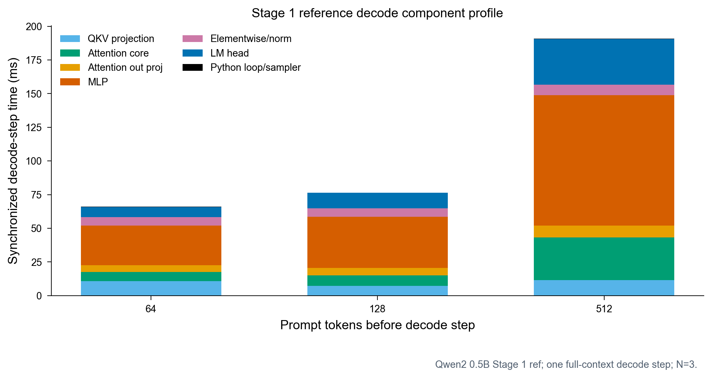

# Stage 1 Decode Component Profile

Date: 2026-05-29

## Goal

This is a Phase 0.5 diagnostic step between Phase 0 benchmarking and Phase 1
implementation.

The previous Phase 0 results showed that the Stage 1 reference implementation
has a large decode bottleneck, and that the bottleneck grows with prompt
length. This profile asks a narrower question:

Which coarse code regions account for one Stage 1 decode step?

This is not an optimization and not a replacement for the throughput
benchmark. It is synchronized component timing around the Stage 1 reference
code path.

## Method

Script:

```bash
pdm run python benches/stage1_decode_component_profile.py
```

Measured setup:

- Model: Qwen2 0.5B Stage 1 reference path
- Device: Apple Silicon GPU through MLX
- Prompt tokens before the measured decode step: 64, 128, 512
- Measured operation: one full-context decode step
- Repetitions: N=3 per prompt length
- Timing method: synchronized MLX component timing with `mx.eval`

The measured components are:

- QKV projection
- attention core
- attention output projection
- MLP
- elementwise/norm/reshape work
- LM head
- outer Python loop, concat, and sampler

Files:

- Script: `benches/stage1_decode_component_profile.py`
- Raw CSV: `benches/stage1_decode_component_profile_results.csv`
- Summary CSV: `benches/stage1_decode_component_profile_summary.csv`
- Figure: `benches/stage1_decode_component_profile.png`
- Vector exports: `benches/stage1_decode_component_profile.pdf`,
  `benches/stage1_decode_component_profile.svg`
- TIFF export: `benches/stage1_decode_component_profile.tiff`



## Results

| Prompt tokens | Total measured decode step | QKV projection | Attention core | Attention out proj | MLP | Elementwise/norm | LM head | Python loop/sampler |
|---:|---:|---:|---:|---:|---:|---:|---:|---:|
| 64 | 66.07 ms | 10.77 ms | 6.80 ms | 5.07 ms | 29.38 ms | 6.16 ms | 7.69 ms | 0.20 ms |
| 128 | 76.50 ms | 7.17 ms | 7.79 ms | 5.58 ms | 37.95 ms | 6.36 ms | 11.46 ms | 0.20 ms |
| 512 | 190.90 ms | 11.38 ms | 31.83 ms | 8.89 ms | 96.64 ms | 7.98 ms | 33.96 ms | 0.22 ms |

Share at prompt length 512:

| Component | Share |
|---|---:|
| MLP | 50.6% |
| LM head | 17.8% |
| Attention core | 16.7% |
| QKV projection | 6.0% |
| Attention output projection | 4.7% |
| Elementwise/norm | 4.2% |
| Python loop/sampler | 0.1% |

## Interpretation

The main bottleneck is not the Python loop itself. The outer loop, concat, and
sampler account for only about 0.1% to 0.3% of the synchronized decode-step
time in this profile.

The main cost comes from re-running full-context transformer computation for
every generated token:

- The MLP dominates the measured step, reaching about 50.6% at prompt 512.
- The LM head also grows with context length, because the Stage 1 model returns
  logits for the whole sequence and only then selects the last position.
- The attention core grows from 6.80 ms at prompt 64 to 31.83 ms at prompt
  512, which matches the earlier context-length bottleneck story.

This strengthens the Phase 0 conclusion. The Stage 1 decode problem is not
primarily "Python is slow." It is that the Stage 1 path performs full-sequence
work during every decode step.

## Research Consequence

This result supports the following ordering:

1. Finish or start Phase 1 Stage 1 implementation as a faithful baseline.
2. Keep the current component profile as the pre-optimization diagnostic.
3. In Phase 2, introduce KV cache first.
4. After KV cache, examine whether LM head slicing and quantized matmul become
   the next dominant costs.

For the 2026-07-01 formal update, this can be presented as a bridge:

Phase 0 measured the decode bottleneck; this profile explains where the
full-context decode step spends time; Phase 1 will now implement the faithful
baseline before introducing optimizations.

## Caveats

These are synchronized component timings, not an exact MLX kernel trace.
Calling `mx.eval` around each component changes scheduling and should not be
compared directly to the end-to-end throughput benchmark.

The profile is only for Qwen2 0.5B. It is enough for mechanism attribution, but
the exact percentage split may change for 1.5B or 7B.

The startup message `Failed to load C++/Metal extension` is expected in this
environment and does not affect this Stage 1 profile. The Stage 1 path measured
here does not use the Stage 2 C++/Metal extension.
