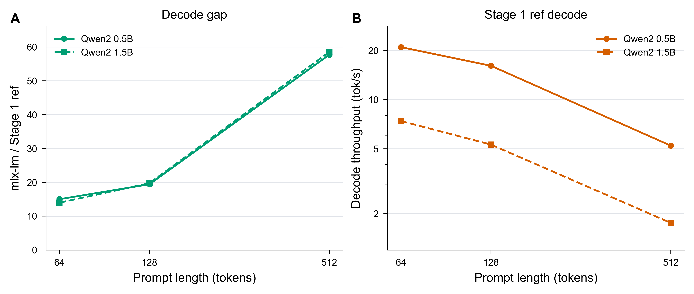
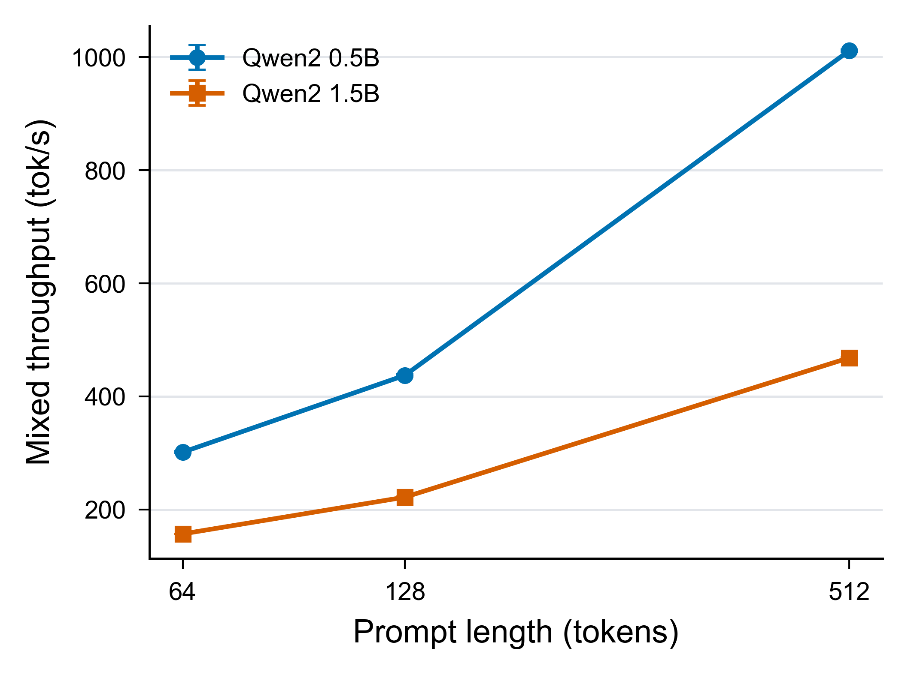

# Workload Length Scan: Prompt Length vs Decode Gap

Date: 2026-05-28

## Goal

This small experiment checks whether the Phase 0 decode gap changes when the prompt becomes longer.

The expectation is:

- mlx-lm should stay mostly stable, because it uses a production decoding path with KV cache.
- SiliconLLM Stage 1 reference should slow down as prompt length grows, because it recomputes attention over the full context during decode.

## Setup

Hardware:

- Apple M3 Pro
- 18 GB unified memory

Models:

- Qwen2 0.5B Instruct MLX
- Qwen2 1.5B Instruct MLX

Engines:

- SiliconLLM Stage 1 reference
- mlx-lm

Workload:

- Prompt length: 64, 128, 512 tokens
- Generation length: 64 tokens
- Number of requests: 2
- Repetitions: N=2
- EOS stopping disabled for mlx-lm during this benchmark, so every request uses the same generation length

Files:

- Script: `benches/workload_length_scan.py`
- 0.5B raw results: `benches/workload_length_scan_results.csv`
- 0.5B summary: `benches/workload_length_scan_summary.csv`
- 1.5B raw results: `benches/workload_length_scan_1p5b_results.csv`
- 1.5B summary: `benches/workload_length_scan_1p5b_summary.csv`
- 0.5B figure: `benches/workload_length_scan.png`
- Combined figure: `benches/workload_length_scan_combined.png`

## Results

| Engine | Model | Prompt tokens | Gen tokens | Decode tok/s |
|---|---|---:|---:|---:|
| SiliconLLM Stage 1 ref | Qwen2 0.5B | 64 | 64 | 20.98 ± 0.012 |
| SiliconLLM Stage 1 ref | Qwen2 0.5B | 128 | 64 | 16.12 ± 0.005 |
| SiliconLLM Stage 1 ref | Qwen2 0.5B | 512 | 64 | 5.22 ± 0.047 |
| mlx-lm | Qwen2 0.5B | 64 | 64 | 314.39 ± 0.026 |
| mlx-lm | Qwen2 0.5B | 128 | 64 | 312.84 ± 0.562 |
| mlx-lm | Qwen2 0.5B | 512 | 64 | 301.33 ± 0.519 |
| SiliconLLM Stage 1 ref | Qwen2 1.5B | 64 | 64 | 7.39 ± 0.137 |
| SiliconLLM Stage 1 ref | Qwen2 1.5B | 128 | 64 | 5.30 ± 0.005 |
| SiliconLLM Stage 1 ref | Qwen2 1.5B | 512 | 64 | 1.76 ± 0.035 |
| mlx-lm | Qwen2 1.5B | 64 | 64 | 103.19 ± 0.757 |
| mlx-lm | Qwen2 1.5B | 128 | 64 | 104.60 ± 0.037 |
| mlx-lm | Qwen2 1.5B | 512 | 64 | 102.78 ± 0.262 |

Decode gap:

| Model | Prompt tokens | mlx-lm / SiliconLLM Stage 1 ref |
|---|---:|---:|
| Qwen2 0.5B | 64 | 15.0× |
| Qwen2 0.5B | 128 | 19.4× |
| Qwen2 0.5B | 512 | 57.7× |
| Qwen2 1.5B | 64 | 14.0× |
| Qwen2 1.5B | 128 | 19.7× |
| Qwen2 1.5B | 512 | 58.5× |

## Interpretation

The result supports the earlier decode-bottleneck explanation.

mlx-lm decode throughput is mostly stable as prompt length increases from 64 to 512 tokens.

SiliconLLM Stage 1 reference behaves very differently. For Qwen2 0.5B, decode throughput drops from about 21 tok/s to about 5.2 tok/s. For Qwen2 1.5B, it drops from about 7.4 tok/s to about 1.8 tok/s.

This means the gap is not only an engine-level constant. It also depends strongly on workload length. With longer prompts, the unoptimized Stage 1 decode path becomes much worse.

## Current Conclusion

The Phase 0 conclusion is now stronger:

- The largest gap is still in decode.
- The gap grows when prompt length grows.
- This is consistent with the lack of KV cache in the Stage 1 reference path.

This is a good next figure for a progress report because it adds a new dimension beyond model size.

## Follow-up: llama.cpp Mixed Workload Scan

I also ran a matching prompt-length scan with llama.cpp Metal, using `llama-bench -pg <prompt,gen>`.

Important metric note: this is not pure decode throughput. `llama-bench -pg` reports mixed prompt+generation throughput for a combined workload. So it should not be directly compared against the pure decode tok/s in the table above.

Files:

- Script: `benches/llama_cpp/llama_cpp_workload_length_scan.py`
- Raw results: `benches/llama_cpp/llama_cpp_workload_length_scan.csv`
- Summary: `benches/llama_cpp/llama_cpp_workload_length_scan_summary.csv`
- Figure: `benches/llama_cpp/llama_cpp_workload_length_scan.png`

Results:

| Engine | Model | Prompt tokens | Gen tokens | Mixed prompt+gen tok/s |
|---|---|---:|---:|---:|
| llama.cpp Metal | Qwen2 0.5B Q4_K_M | 64 | 64 | 301.2 ± 1.64 |
| llama.cpp Metal | Qwen2 0.5B Q4_K_M | 128 | 64 | 437.1 ± 1.71 |
| llama.cpp Metal | Qwen2 0.5B Q4_K_M | 512 | 64 | 1010.9 ± 1.66 |
| llama.cpp Metal | Qwen2 1.5B Q4_K_M | 64 | 64 | 156.7 ± 0.19 |
| llama.cpp Metal | Qwen2 1.5B Q4_K_M | 128 | 64 | 221.7 ± 0.62 |
| llama.cpp Metal | Qwen2 1.5B Q4_K_M | 512 | 64 | 468.0 ± 0.62 |

The mixed throughput increases as prompt length grows. This is expected because the workload contains more prefill work, and llama.cpp prefill is much faster than token-by-token decode. The result is still useful, but mainly as an end-to-end workload measurement and as a reminder that decode-only and mixed workload metrics should be separated.
